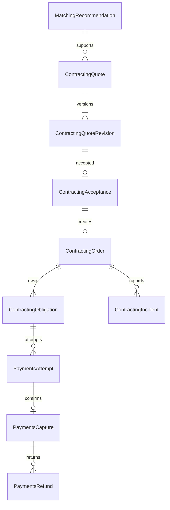
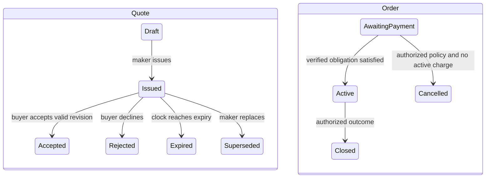
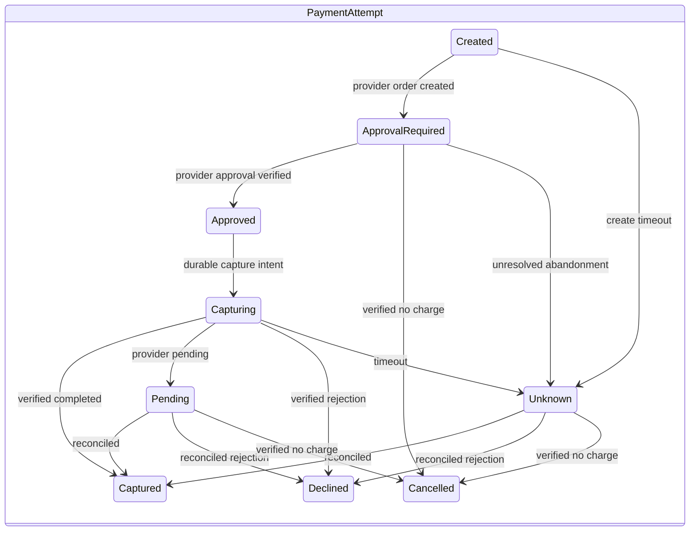
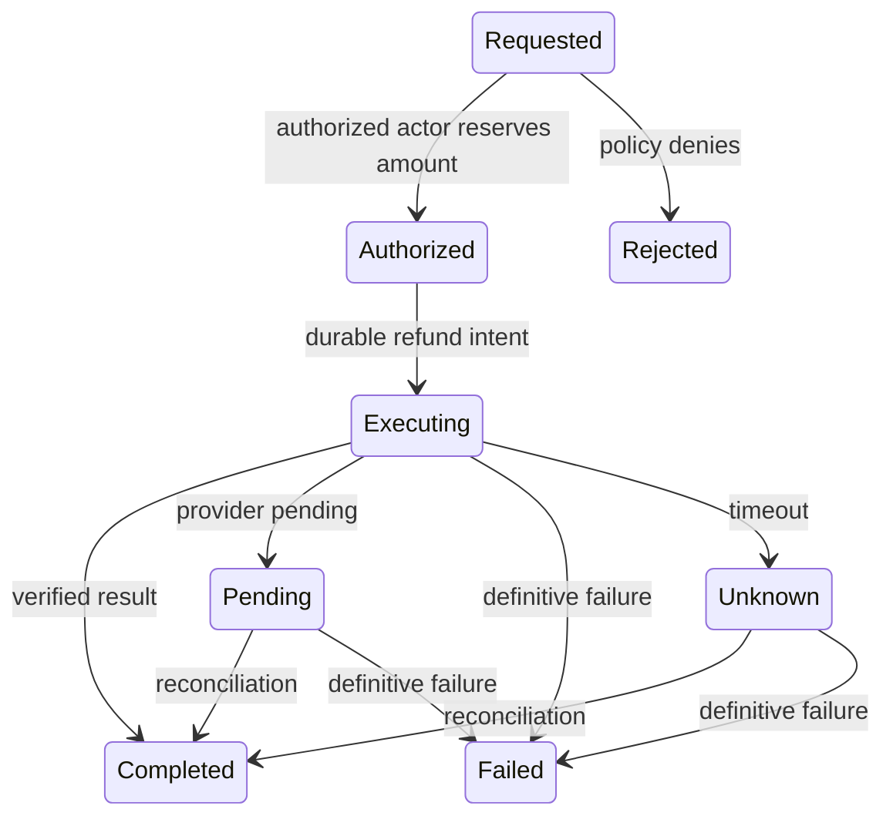

# Dominio y persistencia transaccional

[English](commerce-model.md) · Español

Modelo propuesto. Los módulos actuales se conservan y se amplían con Contracting y Payments. Requests sigue dueño de solicitud y revisión, Matching de recomendaciones y vinculación. No se fusionan estados de negocio con estados financieros.

## Convenciones lógicas
Cada entidad usa id UUID, createdAt UTC y revision bigint para concurrencia, salvo eventos externos inmutables. Campos listados son obligatorios salvo “?”. IDs internos jamás sirven como autorización. FKs entre esquemas se migran coordinadamente, sin lecturas directas ajenas. Dinero usa unidades menores enteras numeric(20,0), currency char(3) y exponente de moneda validado contra catálogo admitido por proveedor. Serializar unidades como string JSON para evitar pérdida de precisión. No asumir dos decimales. Valores negativos se rechazan; moneda y exponente quedan fijados al aceptar. Límites de importe y redondeo pendientes D-09.

## Diccionario de datos
| Entidad y módulo | Campos relevantes propuestos | Relaciones y restricciones | Índices y retención |
|---|---|---|---|
| Actor / Access | role, identitySubject?, recoveryBinding? | Subject único si existe. Buyer/maker/staff según política. | Índice subject. PII separada, retención D-07. |
| Maker / Makers | actorId?, displayName, eligibilityStatus, availability, profilePermission | Actor puede gestionar varios makers solo bajo autorización explícita. | Publicación y disponibilidad para búsqueda. Borrado lógico si hay contratos. |
| Work / Makers | makerId, mediaRef, publicationPermission, permissionEvidence | Maker 1 a N obras. Revocación oculta publicación. | makerId y visible. Retención de evidencia D-03/07. |
| Request / Requests | buyerId, product, budget, references, country, language, deadline, state | Actor 1 a N solicitudes. Seis grupos de entrada según RN-002. | buyerId/state/createdAt, cola interna por estado. PII D-07. |
| Review / Requests | requestId, staffId, decision, note, at | Request 1 a N revisiones, autor obligatorio. | requestId/at. Evidencia restringida. |
| Recommendation / Matching | requestId, makerId, reason, publishedRevision?, outcome | Par request/maker único en revisión activa, máximo tres mediante agregado y bloqueo de publicación. | requestId/revision. Historial conservado. |
| Permission / Matching | recommendationId, grantingActorId, recipientId, scope, decision, at | N decisiones por recomendación. Aplicar última decisión válida bajo política. | recommendationId/recipientId/at. Retención D-04/07. |
| Introduction / Matching | recommendationId, authorizedRevision, actorId, deliveryState | Hasta una presentación vigente por recomendación y revisión autorizada. | Único recommendation/revision. Reintentos en operación durable. |
| MatchingOutcome / Matching | requestId, category, authorId, at | Máximo un resultado actual y correcciones auditadas. | requestId único. Independiente del pedido. |
| Quote / Contracting | requestId, recommendationId, makerId, buyerId, state | Recomendación 1 a N cotizaciones históricas. | buyerId/state y makerId/state. No borrar aceptadas. |
| QuoteRevision / Contracting | quoteId, number, scope, terms, amountMinor, currency, exponent, expiresAt, issuedAt | quoteId/number único, append-only después de emitir. | quoteId/number. Conservación contractual D-07. |
| Acceptance / Contracting | quoteRevisionId, buyerId, termsHash, acceptedAt | Una aceptación por revisión. Debe coincidir titular y hash. | quoteRevisionId único. Evidencia inmutable. |
| Order / Contracting | acceptanceId, requestId, makerId, buyerId, snapshot, state, financialSummary | aceptación 1 a 0..1 pedido. Snapshot incluye alcance, precio, moneda, partes y términos. | acceptanceId único, buyerId/createdAt y makerId/createdAt. Propuesto único pedido activo por request. |
| Obligation / Contracting | orderId, sequence, amountMinor, currency, exponent, status | Pedido 1 a N obligaciones, inicialmente una por total en fixture. Anticipos pendientes. | orderId/sequence único. Snapshot de receptor tras D-08. |
| PaymentAttempt / Payments | obligationId, environment, recipientRef, amount, currency, state, providerOrderId? | Obligación 1 a N intentos históricos, máximo uno activo. | Índice parcial obligationId activo, ID proveedor único con ambiente/receptor. |
| Capture / Payments | attemptId, providerCaptureId, amount, currency, recipientRef, verifiedAt | Intento 1 a 0..1 captura en baseline propuesto. | ID proveedor único por ambiente/receptor; no borrar hechos financieros. |
| Refund / Payments | captureId, requesterId, authorizerId?, amount, state, providerRefundId? | Captura 1 a N devoluciones; suma reservada y completada acotada. | providerRefundId único cuando exista, captureId/state. |
| Operation / Payments | aggregateId, kind, localKey, payloadHash, providerKey, state, leaseUntil?, nextAttemptAt?, attempts | Clave local única por actor/ruta/recurso y tipo. Payload distinto no reutiliza clave. | state/nextAttemptAt para worker. Retención superior a recuperación acordada. |
| InboxEvent / Payments | environment, appRef, providerEventId, type, bodyRef, state | environment/appRef/eventId único. Cuerpo restringido con TTL pendiente. | state/receivedAt. Logs sanitizados. |
| OrderIncident / Contracting | orderId, reporterId, category, resolution?, at | Pedido 1 a N incidencias. | orderId/at. Correcciones auditadas. |

El reembolso requiere bloqueo de la captura durante reserva. Aceptación y creación de pedido comparten transacción para no dejar aceptación parcialmente aplicada. Publicación de matching conserva su transacción por contratos. Payments llama a Contracting para aplicar resumen financiero dentro de una transacción local, sin HTTP. Intenciones externas se confirman fuera de transacción y se recuperan como se describe en [pagos](payments.es.md).

## Relaciones transaccionales

## Estados y transiciones propuestas
Toda transición no listada está prohibida. actor debe estar autorizado y proporcionar revisión esperada en cambios interactivos. Correcciones producen registro compensatorio y no reescriben capturas. Ciclo de solicitud y vinculación sigue en [lifecycle](lifecycle.es.md). Propuestas de expiración y cancelación requieren D-05/09.

| Entidad | Origen → destino | Autoridad, condición y efecto |
|---|---|---|
| Cotización | Draft → Issued | Maker titular valida condiciones y vigencia, congela revisión. |
| Cotización | Issued → Accepted / Rejected | Comprador titular decide revisión vigente. Accepted crea pedido atómicamente. |
| Cotización | Issued → Expired / Superseded | Reloj alcanza expiresAt o maker emite reemplazo. No aceptar después. |
| Pedido | AwaitingPayment → Active | Payments aplica obligación satisfecha según política de anticipos aprobada. |
| Pedido | AwaitingPayment → Cancelled | Actor de política y sin pago activo/incierto. |
| Pedido | Active → Closed | Actor aprobado registra resultado, no certifica entrega garantizada. |
| Intento | Created → ApprovalRequired → Approved | Proveedor crea orden y confirma aprobación. No marca pedido pagado. |
| Intento | Approved → Capturing → Captured / Pending / Declined / Unknown | Backend ejecuta captura; evidencia decide resultado. |
| Intento | Created / ApprovalRequired → Unknown / Cancelled | Timeout o abandono comprobado sin cobro. No usar cancelación del navegador como prueba. |
| Intento | Pending / Unknown → Captured / Declined / Cancelled | Conciliación verifica resultado terminal. |
| Intento | Cualquier no terminal → Quarantined | Discrepancia de importe, moneda o receptor. Revisión humana requerida. |
| Reembolso | Requested → Authorized / Rejected | Actor aprobado aplica política y reserva importe al autorizar. |
| Reembolso | Authorized → Executing → Completed / Pending / Failed / Unknown | Backend ejecuta; evidencia decide. |
| Reembolso | Pending / Unknown → Completed / Failed | Consulta proveedor, liberar reserva solo ante fallo definitivo. |

Cancelación de un pedido pagado requiere política y reembolso separado. No se propone reversión automática de Active a Cancelled. Un Capture permanece como hecho aunque luego existan devoluciones o disputas. Resumen financiero del pedido se deriva de capturas y devoluciones, con campos por importe para evitar confundir reembolso parcial con total.

Los diagramas de pagos omiten la salida transversal a Quarantined para legibilidad. La tabla define esa transición para todo estado no terminal.
