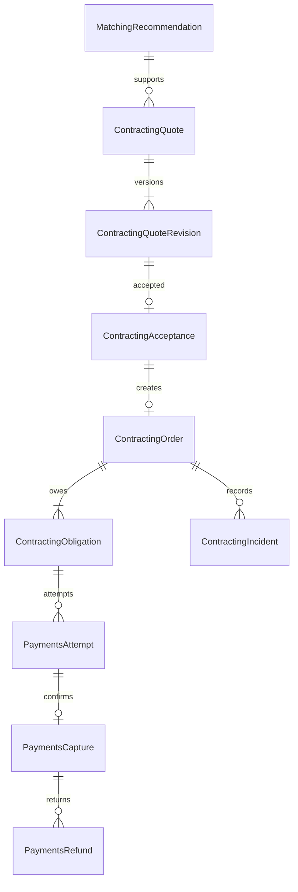
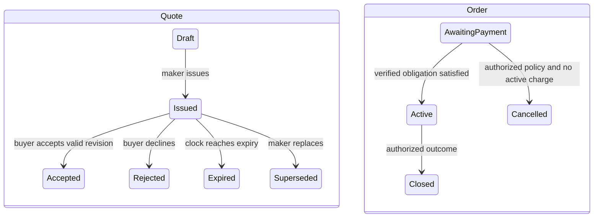
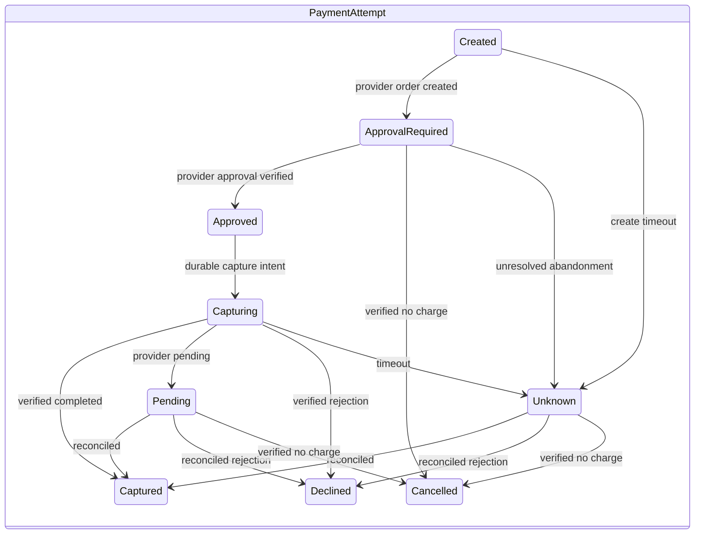
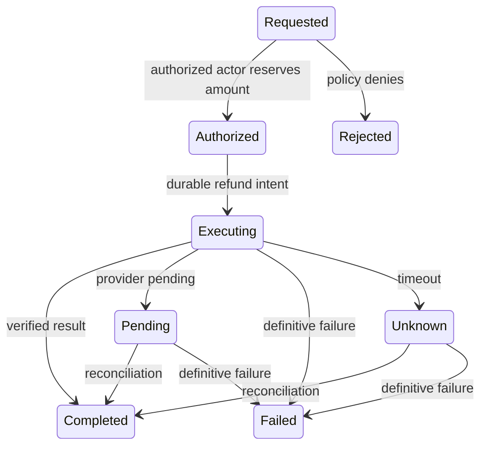

# Transactional domain and persistence

English · [Español](commerce-model.es.md)

Proposed model. Existing modules remain and add Contracting and Payments. Requests owns request and review, Matching owns recommendations and introductions. Business lifecycle and financial states remain separate.

## Logical conventions
Every entity uses UUID id, UTC createdAt and bigint revision for concurrency, except immutable external events. Listed fields are required unless marked “?”. Internal IDs never authorize access. Cross-schema foreign keys migrate in coordination without direct foreign-table reads. Money uses integer minor units numeric(20,0), currency char(3) and currency exponent validated against the provider-supported catalog. Serialize units as JSON strings to preserve precision. Do not assume two decimals. Reject negatives and freeze currency/exponent at acceptance. Amount bounds and rounding await D-09.

## Data dictionary
| Entity and module | Proposed relevant fields | Relationships and constraints | Indexes and retention |
|---|---|---|---|
| Actor / Access | role, identitySubject?, recoveryBinding? | Unique subject when present. Buyer/maker/staff per policy. | Subject index. Separate PII, retention D-07. |
| Maker / Makers | actorId?, displayName, eligibilityStatus, availability, profilePermission | Actor may manage several makers only with explicit authorization. | Publication/availability for browse. Soft delete when contracts exist. |
| Work / Makers | makerId, mediaRef, publicationPermission, permissionEvidence | Maker 1 to N works. Revocation hides publication. | makerId/visible. Evidence retention D-03/07. |
| Request / Requests | buyerId, product, budget, references, country, language, deadline, state | Actor 1 to N requests. Six input groups under RN-002. | buyerId/state/createdAt and staff state queue. PII D-07. |
| Review / Requests | requestId, staffId, decision, note, at | Request 1 to N reviews, author required. | requestId/at. Restricted evidence. |
| Recommendation / Matching | requestId, makerId, reason, publishedRevision?, outcome | Unique request/maker pair in active revision, maximum three via aggregate and publication lock. | requestId/revision. Preserve history. |
| Permission / Matching | recommendationId, grantingActorId, recipientId, scope, decision, at | N decisions per recommendation. Apply latest valid decision under policy. | recommendationId/recipientId/at. Retention D-04/07. |
| Introduction / Matching | recommendationId, authorizedRevision, actorId, deliveryState | At most one active introduction per recommendation and authorized revision. | Unique recommendation/revision. Retries via durable operation. |
| MatchingOutcome / Matching | requestId, category, authorId, at | At most one current outcome with audited corrections. | Unique requestId. Independent of order. |
| Quote / Contracting | requestId, recommendationId, makerId, buyerId, state | Recommendation 1 to N historical quotes. | buyerId/state, makerId/state. Never delete accepted quotes. |
| QuoteRevision / Contracting | quoteId, number, scope, terms, amountMinor, currency, exponent, expiresAt, issuedAt | Unique quoteId/number, append-only after issue. | quoteId/number. Contract retention D-07. |
| Acceptance / Contracting | quoteRevisionId, buyerId, termsHash, acceptedAt | One acceptance per revision. Owner and hash must match. | Unique quoteRevisionId. Immutable evidence. |
| Order / Contracting | acceptanceId, requestId, makerId, buyerId, snapshot, state, financialSummary | Acceptance 1 to 0..1 order. Snapshot includes scope, money, parties and terms. | Unique acceptanceId, buyerId/createdAt, makerId/createdAt. Propose one active order per request. |
| Obligation / Contracting | orderId, sequence, amountMinor, currency, exponent, status | Order 1 to N obligations, initially one for full amount in fixture. Deposits pending. | Unique orderId/sequence. Recipient snapshot after D-08. |
| PaymentAttempt / Payments | obligationId, environment, recipientRef, amount, currency, state, providerOrderId? | Obligation 1 to N historical attempts, maximum one active. | Partial active obligationId index, provider ID unique with environment/recipient. |
| Capture / Payments | attemptId, providerCaptureId, amount, currency, recipientRef, verifiedAt | Attempt 1 to 0..1 capture in proposed baseline. | Unique provider ID per environment/recipient; preserve financial facts. |
| Refund / Payments | captureId, requesterId, authorizerId?, amount, state, providerRefundId? | Capture 1 to N refunds; reserved and completed sum bounded. | Unique providerRefundId when present, captureId/state. |
| Operation / Payments | aggregateId, kind, localKey, payloadHash, providerKey, state, leaseUntil?, nextAttemptAt?, attempts | Local key unique by actor/route/resource and kind. Changed payload cannot reuse key. | state/nextAttemptAt for worker. Retain beyond agreed recovery period. |
| InboxEvent / Payments | environment, appRef, providerEventId, type, bodyRef, state | Unique environment/appRef/eventId. Restricted body with pending TTL. | state/receivedAt. Sanitized logs. |
| OrderIncident / Contracting | orderId, reporterId, category, resolution?, at | Order 1 to N incidents. | orderId/at. Audited corrections. |

Refund reservation locks the capture. Acceptance and order creation share a transaction to avoid partially applied acceptance. Matching publication retains its contract-coordinated transaction. Payments calls Contracting to apply financial summary within a local transaction, without HTTP. External intentions execute outside transactions and recover as defined in [payments](payments.md).

## Transactional relationships

## Proposed states and transitions
Every unlisted transition is forbidden. Actors require authorization and expected revision for interactive changes. Corrections append compensating records rather than rewriting captures. Request and introduction lifecycle stays in [lifecycle](lifecycle.md). Expiry and cancellation proposals await D-05/09.

| Entity | From → to | Authority, guard and effect |
|---|---|---|
| Quote | Draft → Issued | Owning maker validates terms and expiry, freezes revision. |
| Quote | Issued → Accepted / Rejected | Owning buyer decides unexpired revision. Accepted creates order atomically. |
| Quote | Issued → Expired / Superseded | Clock reaches expiresAt or maker issues replacement. No later acceptance. |
| Order | AwaitingPayment → Active | Payments applies satisfied obligation under approved deposit policy. |
| Order | AwaitingPayment → Cancelled | Policy-authorized actor with no active/uncertain payment. |
| Order | Active → Closed | Approved actor records outcome without certifying guaranteed delivery. |
| Attempt | Created → ApprovalRequired → Approved | Provider creates order and verifies approval. Order remains unpaid. |
| Attempt | Approved → Capturing → Captured / Pending / Declined / Unknown | Backend captures; evidence determines result. |
| Attempt | Created / ApprovalRequired → Unknown / Cancelled | Timeout or verified abandonment without charge. Browser cancellation is insufficient evidence. |
| Attempt | Pending / Unknown → Captured / Declined / Cancelled | Reconciliation verifies terminal outcome. |
| Attempt | Any nonterminal → Quarantined | Amount, currency or recipient mismatch requires human review. |
| Refund | Requested → Authorized / Rejected | Approved actor applies policy and reserves amount on authorization. |
| Refund | Authorized → Executing → Completed / Pending / Failed / Unknown | Backend executes; evidence determines result. |
| Refund | Pending / Unknown → Completed / Failed | Query provider; release reservation only on definitive failure. |

Cancelling a paid order needs policy and a separate refund. Automatic Active to Cancelled reversal is not proposed. Capture remains a fact even after refunds or disputes. Order financial summary derives from captures and refunds with amount fields to distinguish partial from full refunds.

Payment diagrams omit the cross-cutting Quarantined exit for readability. The table defines it for every nonterminal state.
