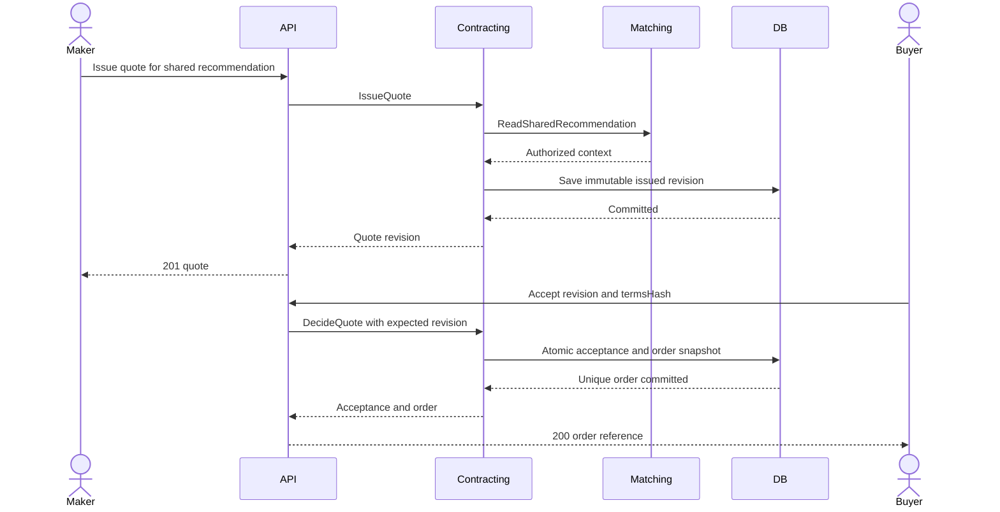

# Casos de uso, API y navegación

[English](contracts.md) · Español

Diseño propuesto. Todos los contratos aquí son futuros. Campos de autorización derivan de sesión y política aprobada, nunca de actorId confiado del cliente. El catálogo de RF define criterios, esta página concreta colaboración.

## Convenciones
Prefijo /api/v1. GET devuelve 200, creación durable 201 con Location, procesamiento externo pendiente 202 con recurso consultable. Mutaciones de recurso exigen If-Match con revision y devuelven ETag. Falta revisión devuelve 428, discrepancia 412; 409 expresa conflicto de negocio. Idempotency-Key en creación, aceptación, publicación, pagos, introducción y reembolso identifica actor, ruta y recurso con hash de cuerpo. Misma clave y cuerpo devuelve recurso original; cuerpo distinto devuelve 409. Guardar clave y efecto en misma transacción. Lecturas ajenas devuelven 404 según propuesta de ocultación. 401 sin sesión, 403 para función no autorizada, 400 formato, 422 reglas de campos, 503 dependencia indisponible. Errores usan code, correlationId y fieldErrors sin secretos. Las políticas definitivas de identidad y recuperación siguen D-01/02.

Listas usan cursor opaco, orden estable createdAt/id y limit entero 1–100, valor predeterminado 20 como propuesta técnica. Respuesta items y nextCursor. El backend limita a datos autorizados antes de paginar.

## Casos de uso y contratos
En todos, repetición GET no cambia estado y mutaciones usan la política anterior. Los errores rechazan sin escritura parcial. “TX” significa transacción PostgreSQL local. Red externa siempre después del commit.

| UC / RF / RN | Actor y entrada → salida | Módulo, contratos, validación, TX y concurrencia |
|---|---|---|
| UC-01 / RF-006/013 / RN-003 | Operador maker autorizado, perfil/obras/permiso → perfil visible; visitante consulta. | Makers.PublishProfile / ReadPublic. Titularidad y permiso por obra. TX de publicación, revision. Revocación oculta lectura. |
| UC-02 / RF-002/003/009/010 / RN-001/002/008 | Comprador datos → solicitud; personal revisión → estado. | Requests.Create / ReadOwned / Review; Access.ResolveActor. Edad y seis campos, TX por comando, revision de solicitud. Reintento crear deduplicado. |
| UC-03 / RF-004/005/007/011/012 / RN-004–009 | Personal selección/motivos → publicación; partes permiso → presentación. | Matching.Curate / Publish / GrantPermission; Makers.CheckEligibility; Requests.Transition. Hasta tres, motivos y permisos. TX compartida al publicar, revision. Entrega externa con intención durable. |
| UC-04 / RF-014 / RN-012 | Maker autorizado importe/alcance/vigencia → cotización emitida. | Contracting.IssueQuote; Matching.ReadSharedRecommendation; Makers.CheckEligibility. Datos compartidos por consentimiento, moneda admitida, fecha futura. TX congela revisión, If-Match. |
| UC-05 / RF-015/016 / RN-012/013 | Comprador decisión/revisión/hash → rechazo o aceptación con pedido. | Contracting.DecideQuote / CreateOrder. Vigente, titular, snapshot, solo un pedido activo propuesto. TX aceptación y pedido, bloqueo de solicitud lógica por contrato para competencia entre cotizaciones. Índices únicos; repetición devuelve mismo pedido. |
| UC-06 / RF-017 / RN-014 | Comprador orderId → intento/acción de aprobación. | Payments.Start; Contracting.ReservePayableObligation. Comprobar receptor aprobado y obligación pendiente. TX reserva e intención. Llamada CreateOrder posterior, reserva única. |
| UC-07 / RF-018 / RN-015 | Comprador propietario pide captura → intento actualizado. | Payments.Capture; PaymentGateway.Capture; Contracting.ApplyFinancialStatus. Aprobación comprobada, dinero y receptor. TX de intención, HTTP, TX de resultado. Lease y claves estables. |
| UC-08 / RF-019 / RN-015 | PayPal headers/cuerpo → recibo y procesamiento. | Payments.ReceiveEvent; PaymentGateway.VerifyWebhook / ReadCapture. Autenticidad, correlación y deduplicación. Inbox TX y aplicación TX posterior. Eventos no reconocidos no cambian negocio. |
| UC-09 / RF-020 / RN-015 | Worker o personal attemptId → estado conciliado o escalado. | Payments.Reconcile; PaymentGateway.ReadOrder / ReadCapture. Lease expirable, consulta fuera TX, resultado aplicado idempotente. Sin evidencia mantener Unknown. |
| UC-10 / RF-021 / RN-016 | Comprador solicitud, autorizador decisión → devolución consultable. | Payments.RequestRefund / AuthorizeRefund / ExecuteRefund; Contracting.ReadAgreement. Política, saldo capturado, reserva bajo bloqueo. TX por fase, operación proveedor fuera TX. Repetición misma devolución. |
| UC-11 / RF-022/023/008 / RN-010/017/018 | Actor aprobado motivo/resultado → cancelación, incidencia o resultado independiente. | Contracting.Cancel / RecordOutcome / ReportIncident; Matching.RecordOutcome. Sin cobro incierto para cancelar; no propagar resultado a todas recomendaciones. TX por agregado, correcciones auditadas. |

## Contratos HTTP
Sufijos y recursos corresponden al prefijo anterior. “M” indica If-Match e “I” Idempotency-Key. Request y response son nombres de DTO definidos por campos en esta tabla y el modelo lógico. Errores comunes siguen las convenciones.

| HTTP / route | Actor / UC / RF | Request → success | Conflictos específicos |
|---|---|---|---|
| GET /service | public / RF-001 | none → 200 service scope | 503 |
| GET /makers, /makers/{id} | public / UC-01 / RF-006 | cursor/limit → profile(s), authorized works | 404 withdrawn |
| PUT /makers/{id}, /makers/{id}/works/{workId} | authorized operator / UC-01 / RF-013 | M profile/permission/evidence → 200 revision | 422 missing permission |
| POST /requests | buyer / UC-02 / RF-002 | I product,budget,references,country,language,deadline,agePolicyEvidence → 201 id,state,revision | 422 incomplete |
| GET /requests, /requests/{id} | owner or staff / UC-02 / RF-009/003 | cursor/limit/state → request(s) | 404 foreign |
| POST /requests/{id}/reviews | staff / UC-02 / RF-003 | M,I decision,note → 201 review,state | 409 transition |
| PUT /requests/{id}/recommendations | staff / UC-03 / RF-004 | M makerIds,reasons → 200 draft,revision | 422 fourth/duplicate |
| POST /requests/{id}/publication | staff / UC-03 / RF-011 | M,I noMatch or revision → 200 published | 409 eligibility |
| GET /requests/{id}/recommendations | owner / UC-03 / RF-005 | none → published makers/reasons | 404 draft |
| POST /recommendations/{id}/permissions | required party / UC-03 / RF-007 | M,I recipientId,scope,decision → 201 permission | 422 scope |
| POST /recommendations/{id}/introductions | staff / UC-03 / RF-012 | M,I authorizedRevision → 202 deliveryState | 409 missing permission |
| PUT /requests/{id}/outcome | staff / UC-11 / RF-008 | M category → 200 outcome | 409 transition |
| POST /recommendations/{id}/quotes | owning maker / UC-04 / RF-014 | I scope,terms,money,expiresAt → 201 quoteId,revision,state | 409 not shared |
| POST /quotes/{id}/revisions | owning maker / UC-04 / RF-014 | M,I scope,terms,money,expiresAt → 201 new revision | 409 accepted quote requires new agreement |
| GET /quotes, /quotes/{id} | owning buyer/maker, permitted staff / UC-04/05 / RF-014/015 | cursor/limit → quote revisions | 404 foreign |
| POST /quotes/{id}/decision | owning buyer / UC-05 / RF-015/016 | M,I decision,revision,termsHash → 200 acceptanceId,orderId or rejection | 409 expired/other order |
| GET /orders, /orders/{id} | owning buyer/maker, permitted staff / UC-05 / RF-016 | cursor/limit → snapshot,state,financialSummary | 404 foreign |
| POST /orders/{id}/payment-attempts | owning buyer / UC-06 / RF-017 | I obligationId → 201/202 attemptId,state,approvalAction? | 409 reserved |
| GET /payment-attempts/{id} | owner, permitted staff / UC-07/09 / RF-018/020 | none → state,orderId,verifiedSummary | 404 foreign |
| POST /payment-attempts/{id}/capture | owning buyer / UC-07 / RF-018 | I no money fields → 200/202 attempt state | 409 not approved |
| GET /operations | financial staff / UC-09 / RF-020 | cursor/limit/state → pending reconciliation summaries | 403 role |
| POST /payment-attempts/{id}/reconciliation | staff / UC-09 / RF-020 | I reason → 202 operationId | 409 lease active |
| POST /webhooks/paypal | verified provider / UC-08 / RF-019 | transmission headers/raw event → 200 durable receipt | 400 signature,503 verify/store |
| POST /orders/{id}/refund-requests | owning buyer or permitted staff / UC-10 / RF-021 | I amount,reason → 201 refund request | 409 uncertain capture |
| POST /refunds/{id}/authorization | approved authorizer / UC-10 / RF-021 | M,I decision,reason → 200/202 authorized/rejected | 409 insufficient balance |
| GET /refunds/{id} | owning buyer/maker, permitted staff / UC-10 / RF-021 | none → refund state,amount | 404 foreign |
| POST /orders/{id}/cancellation | policy-authorized actor / UC-11 / RF-022 | M,I reason → 200 cancelled | 409 payment active |
| POST /orders/{id}/incidents | party or staff / UC-11 / RF-023 | I category,description → 201 incident | 422 category |
| PUT /orders/{id}/outcome | approved actor / UC-11 / RF-023 | M category → 200 outcome | 409 transition |

## Ejemplos sin datos reales
```json
{"scope":"Fictional paws","terms":"Sample terms revision 1","money":{"minorUnits":"12500","currency":"USD","exponent":2},"expiresAt":"2027-01-15T12:00:00Z"}
```
```json
{"decision":"accept","revision":1,"termsHash":"example-hash"}
```
```json
{"acceptanceId":"00000000-0000-4000-8000-000000000001","orderId":"00000000-0000-4000-8000-000000000002","state":"AwaitingPayment"}
```
```json
{"code":"payment_result_unknown","correlationId":"example-run","fieldErrors":{}}
```
## Pantallas y navegación
Todas deben distinguir carga (acciones bloqueadas), vacío (siguiente acción permitida), éxito y error recuperable con mensaje y correlación. 401 dirige a acceso; 403/404 no muestran datos. 412 invita a recargar sin sobrescribir. Validación presenta campos y foco accesible. Paginar listas. Criterio general de aceptación es completar acción, recargar y conservar estado sin revelar recursos ajenos.

| Pantalla / actor | Datos, acciones y endpoints | Navegación y aceptación específica |
|---|---|---|
| Servicio y directorio / visitante | GET service, makers. Perfil y obras autorizadas. | Inicio → maker → solicitud. Revocación oculta obras. |
| Nueva solicitud / comprador | POST requests, seis grupos y política adulta. | → detalle propio. Errores por campo no crean envío. |
| Solicitud y selección / comprador | GET request y recommendations, POST permission. | → maker/cotizaciones. Vacío explica sin compatibilidad; borradores ocultos. |
| Cola y revisión / personal | GET requests paginado, POST review, PUT recommendations, POST publication. | Cola → revisión → selección. Cuarto maker rechazado, publicación consistente. |
| Gestión maker / operador autorizado | PUT maker y obras. | Panel → perfil público. Permisos de titularidad y publicación. |
| Cotizaciones / maker | GET quotes, POST quote para recomendación compartida. | → revisión emitida. Vigencia y dinero validados. |
| Cotización / comprador | GET quote, POST decision. Mostrar hash/revisión, alcance y términos. | Rechazo conserva decisión; aceptar → pedido único. Expirada deshabilita aceptar. |
| Checkout / comprador | GET order, POST payment-attempt, mecanismo aprobación, POST capture. | → resultado. Dinero solo lectura; doble clic no duplica. Abandono permite consultar. |
| Resultado de pago / comprador | GET attempt y order, polling acotado. | → pedido. Pending/Unknown nunca dicen pagado, ofrecer actualizar sin nuevo cobro. |
| Pedido / partes autorizadas | GET order/refund, POST refund-request/incident/cancellation. | → detalle de devolución/incidencia. Snapshot estable, estado financiero distinto del pedido. |
| Gestión financiera / personal autorizado | POST reconciliation/refund authorization, GET intento/pedido. | Cola de conciliación → evidencia → decisión. Permisos de devolución separados de revisar solicitudes. |
| Acceso y recuperación / actor | Contrato de autenticación pendiente D-01/02/11. | Retornar a recurso solo tras autorización. No diseñar endpoints de identidad definitivos antes de decisión. |

Maker emite cotización desde recomendación compartida por consentimiento. Permisos de makers pendientes D-11 no impiden diseñar el caso, pero bloquean habilitarlo con datos reales.


