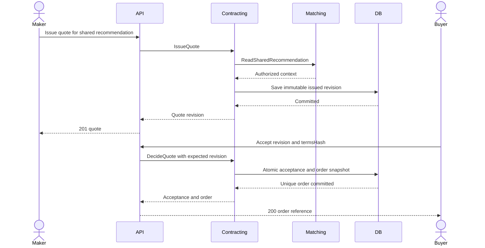

# Use cases, API and navigation

English · [Español](contracts.es.md)

Proposed design. All contracts here are future. Authorization derives from session and approved policy, never from a trusted client actorId. RF defines acceptance, this page specifies collaboration.

## Conventions
Use /api/v1 prefix. GET returns 200, durable creation 201 with Location, pending external processing 202 with a readable resource. Resource updates require If-Match revision and return ETag. Missing revision returns 428, mismatch 412; 409 expresses business conflict. Idempotency-Key on creation, acceptance, publication, payments, introduction and refund identifies actor, route and resource with a body hash. Same key/body returns the original resource; changed body returns 409. Store key and effect in one transaction. Foreign resource reads return 404 under proposed disclosure policy. Return 401 without session, 403 for unauthorized functions, 400 for malformed input, 422 for field rules and 503 for unavailable dependencies. Errors use code, correlationId and fieldErrors without secrets. Final identity and recovery policies await D-01/02.

Lists use an opaque cursor, stable createdAt/id ordering and integer limit 1–100, default 20 as a technical proposal. Response has items and nextCursor. Filter authorization before pagination.

## Use cases and contracts
For every row, repeated GET has no mutation and writes use the above policy. Errors reject without partial writes. “TX” means local PostgreSQL transaction. External network calls always follow commit.

| UC / RF / RN | Actor and input → output | Module, contracts, validation, TX and concurrency |
|---|---|---|
| UC-01 / RF-006/013 / RN-003 | Authorized maker operator, profile/works/permission → visible profile; visitor reads. | Makers.PublishProfile / ReadPublic. Ownership and per-work permission. Publication TX, revision. Revocation hides reads. |
| UC-02 / RF-002/003/009/010 / RN-001/002/008 | Buyer input → request; staff review → state. | Requests.Create / ReadOwned / Review; Access.ResolveActor. Age and six fields, TX per command, request revision. Deduplicated creation retry. |
| UC-03 / RF-004/005/007/011/012 / RN-004–009 | Staff shortlist/reasons → publication; parties permission → introduction. | Matching.Curate / Publish / GrantPermission; Makers.CheckEligibility; Requests.Transition. Up to three, reasons and permission. Shared publication TX, revision. External delivery uses durable intent. |
| UC-04 / RF-014 / RN-012 | Authorized maker amount/scope/expiry → issued quote. | Contracting.IssueQuote; Matching.ReadSharedRecommendation; Makers.CheckEligibility. Consent-shared data, supported currency, future expiry. TX freezes revision, If-Match. |
| UC-05 / RF-015/016 / RN-012/013 | Buyer decision/revision/hash → rejection or acceptance with order. | Contracting.DecideQuote / CreateOrder. Valid, owner, snapshot, proposed one active order. Acceptance/order TX, logical request serialization through contract for competing quotes. Unique indexes; replay returns same order. |
| UC-06 / RF-017 / RN-014 | Buyer orderId → attempt/approval action. | Payments.Start; Contracting.ReservePayableObligation. Check approved recipient and unpaid obligation. Reservation/intent TX. Later CreateOrder call, unique reservation. |
| UC-07 / RF-018 / RN-015 | Owning buyer requests capture → updated attempt. | Payments.Capture; PaymentGateway.Capture; Contracting.ApplyFinancialStatus. Verified approval, money and recipient. Intent TX, HTTP, result TX. Lease and stable keys. |
| UC-08 / RF-019 / RN-015 | PayPal headers/body → receipt and processing. | Payments.ReceiveEvent; PaymentGateway.VerifyWebhook / ReadCapture. Authenticity, correspondence and deduplication. Inbox TX then application TX. Unknown events do not mutate business. |
| UC-09 / RF-020 / RN-015 | Worker or staff attemptId → reconciled or escalated state. | Payments.Reconcile; PaymentGateway.ReadOrder / ReadCapture. Expiring lease, query outside TX, idempotent result application. Preserve Unknown without evidence. |
| UC-10 / RF-021 / RN-016 | Buyer request, authorizer decision → readable refund. | Payments.RequestRefund / AuthorizeRefund / ExecuteRefund; Contracting.ReadAgreement. Policy, captured balance, locked reservation. TX per phase, provider operation outside TX. Replay returns same refund. |
| UC-11 / RF-022/023/008 / RN-010/017/018 | Approved actor reason/outcome → cancellation, incident or independent outcome. | Contracting.Cancel / RecordOutcome / ReportIncident; Matching.RecordOutcome. No uncertain charge for cancellation; never propagate outcome to all recommendations. TX per aggregate, audited corrections. |

## HTTP contracts
Routes use the above prefix. “M” means If-Match and “I” means Idempotency-Key. Request and response DTO fields are specified here and in the logical model. Common errors follow the conventions.

| HTTP / route | Actor / UC / RF | Request → success | Specific conflicts |
|---|---|---|---|
| GET /service | public / RF-001 | none → 200 service scope | 503 |
| GET /makers, /makers/{id} | public / UC-01 / RF-006 | cursor/limit → profile(s), authorized works | 404 withdrawn |
| PUT /makers/{id}, /makers/{id}/works/{workId} | authorized operator / UC-01 / RF-013 | M profile/permission/evidence → 200 revision | 422 missing permission |
| POST /requests | buyer / UC-02 / RF-002 | I product,budget,references,country,language,deadline,agePolicyEvidence → 201 id,state,revision | 422 incomplete |
| GET /requests, /requests/{id} | owner or staff / UC-02 / RF-009/003 | cursor/limit/state → request(s) | 404 foreign |
| POST /requests/{id}/reviews | staff / UC-02 / RF-003 | M,I decision,note → 201 review,state | 409 transition |
| PUT /requests/{id}/recommendations | staff / UC-03 / RF-004 | M makerIds,reasons → 200 draft,revision | 422 fourth/duplicate |
| POST /requests/{id}/publication | staff / UC-03 / RF-011 | M,I noMatch or revision → 200 published | 409 eligibility |
| GET /requests/{id}/recommendations | owner / UC-03 / RF-005 | none → published makers/reasons | 404 draft |
| POST /recommendations/{id}/permissions | required party / UC-03 / RF-007 | M,I recipientId,scope,decision → 201 permission | 422 scope |
| POST /recommendations/{id}/introductions | staff / UC-03 / RF-012 | M,I authorizedRevision → 202 deliveryState | 409 missing permission |
| PUT /requests/{id}/outcome | staff / UC-11 / RF-008 | M category → 200 outcome | 409 transition |
| POST /recommendations/{id}/quotes | owning maker / UC-04 / RF-014 | I scope,terms,money,expiresAt → 201 quoteId,revision,state | 409 not shared |
| POST /quotes/{id}/revisions | owning maker / UC-04 / RF-014 | M,I scope,terms,money,expiresAt → 201 new revision | 409 accepted quote requires new agreement |
| GET /quotes, /quotes/{id} | owning buyer/maker, permitted staff / UC-04/05 / RF-014/015 | cursor/limit → quote revisions | 404 foreign |
| POST /quotes/{id}/decision | owning buyer / UC-05 / RF-015/016 | M,I decision,revision,termsHash → 200 acceptanceId,orderId or rejection | 409 expired/other order |
| GET /orders, /orders/{id} | owning buyer/maker, permitted staff / UC-05 / RF-016 | cursor/limit → snapshot,state,financialSummary | 404 foreign |
| POST /orders/{id}/payment-attempts | owning buyer / UC-06 / RF-017 | I obligationId → 201/202 attemptId,state,approvalAction? | 409 reserved |
| GET /payment-attempts/{id} | owner, permitted staff / UC-07/09 / RF-018/020 | none → state,orderId,verifiedSummary | 404 foreign |
| POST /payment-attempts/{id}/capture | owning buyer / UC-07 / RF-018 | I no money fields → 200/202 attempt state | 409 not approved |
| GET /operations | financial staff / UC-09 / RF-020 | cursor/limit/state → pending reconciliation summaries | 403 role |
| POST /payment-attempts/{id}/reconciliation | staff / UC-09 / RF-020 | I reason → 202 operationId | 409 lease active |
| POST /webhooks/paypal | verified provider / UC-08 / RF-019 | transmission headers/raw event → 200 durable receipt | 400 signature,503 verify/store |
| POST /orders/{id}/refund-requests | owning buyer or permitted staff / UC-10 / RF-021 | I amount,reason → 201 refund request | 409 uncertain capture |
| POST /refunds/{id}/authorization | approved authorizer / UC-10 / RF-021 | M,I decision,reason → 200/202 authorized/rejected | 409 insufficient balance |
| GET /refunds/{id} | owning buyer/maker, permitted staff / UC-10 / RF-021 | none → refund state,amount | 404 foreign |
| POST /orders/{id}/cancellation | policy-authorized actor / UC-11 / RF-022 | M,I reason → 200 cancelled | 409 payment active |
| POST /orders/{id}/incidents | party or staff / UC-11 / RF-023 | I category,description → 201 incident | 422 category |
| PUT /orders/{id}/outcome | approved actor / UC-11 / RF-023 | M category → 200 outcome | 409 transition |

## Examples without real data
```json
{"scope":"Fictional paws","terms":"Sample terms revision 1","money":{"minorUnits":"12500","currency":"USD","exponent":2},"expiresAt":"2027-01-15T12:00:00Z"}
```
```json
{"decision":"accept","revision":1,"termsHash":"example-hash"}
```
```json
{"acceptanceId":"00000000-0000-4000-8000-000000000001","orderId":"00000000-0000-4000-8000-000000000002","state":"AwaitingPayment"}
```
```json
{"code":"payment_result_unknown","correlationId":"example-run","fieldErrors":{}}
```
## Screens and navigation
Every screen distinguishes loading (actions disabled), empty (allowed next action), success and recoverable error with message and correlation. 401 leads to access; 403/404 disclose no data. 412 offers reload without overwrite. Validation identifies fields with accessible focus. Paginate lists. General acceptance is action completion, persisted state on reload and no foreign-resource disclosure.

| Screen / actor | Data, actions and endpoints | Navigation and specific acceptance |
|---|---|---|
| Service and directory / visitor | GET service, makers. Authorized profiles and works. | Home → maker → request. Revocation hides works. |
| New request / buyer | POST requests, six groups and adult policy. | → own detail. Field errors create no submission. |
| Request and shortlist / buyer | GET request and recommendations, POST permission. | → maker/quotes. Empty explains no match; drafts stay hidden. |
| Queue and review / staff | Paginated GET requests, POST review, PUT recommendations, POST publication. | Queue → review → shortlist. Fourth maker rejected, consistent publication. |
| Maker management / authorized operator | PUT maker and works. | Dashboard → public profile. Ownership and publication permissions. |
| Quotes / maker | GET quotes, POST quote for shared recommendation. | → issued revision. Validate expiry and money. |
| Quote / buyer | GET quote, POST decision. Show hash/revision, scope and terms. | Rejection persists; accept → unique order. Expired disables acceptance. |
| Checkout / buyer | GET order, POST payment-attempt, approval mechanism, POST capture. | → result. Money read-only; double click cannot duplicate. Abandonment permits lookup. |
| Payment result / buyer | GET attempt and order, bounded polling. | → order. Pending/Unknown never say paid; offer refresh without new charge. |
| Order / authorized parties | GET order/refund, POST refund-request/incident/cancellation. | → refund/incident detail. Stable snapshot, financial status separate from lifecycle. |
| Financial operations / authorized staff | POST reconciliation/refund authorization, GET attempt/order. | Reconciliation queue → evidence → decision. Refund permission separate from request review. |
| Access and recovery / actor | Authentication contract pending D-01/02/11. | Return to resource only after authorization. Identity endpoints await decision. |

Makers issue quotes from consent-shared recommendations. Pending D-11 maker permissions do not prevent designing the case but block enabling real-data access.


