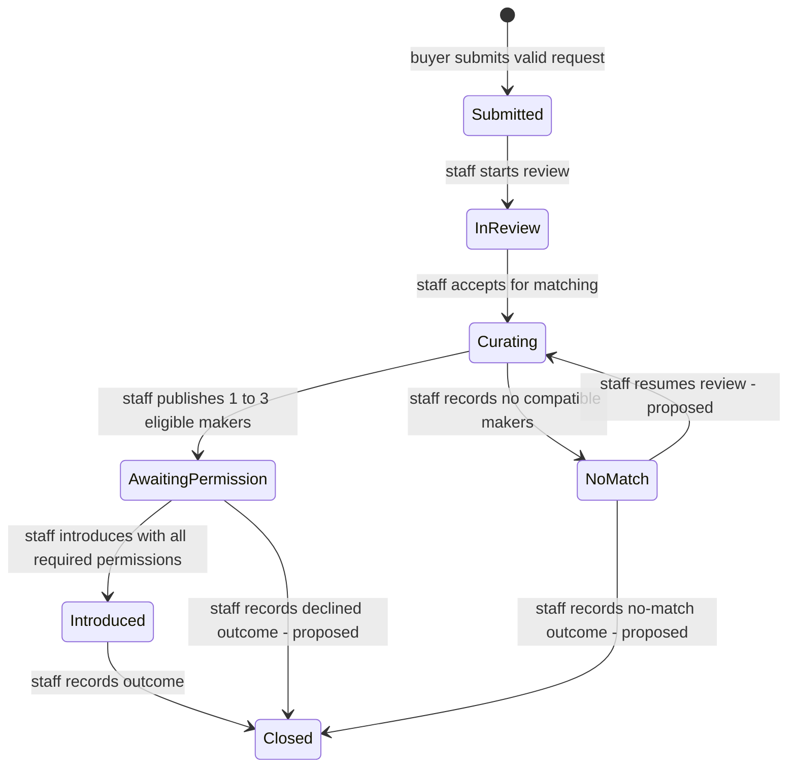
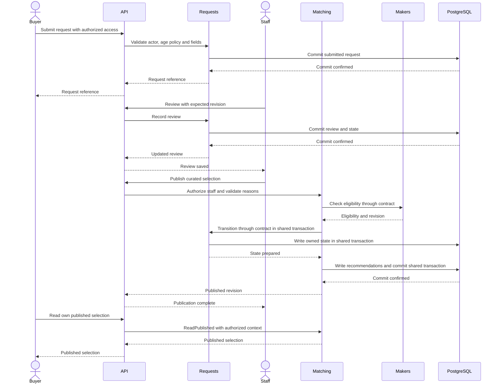

# Ciclo de vida propuesto

[English](lifecycle.md) · Español

Este diseño desarrolla RN-008 y RN-009 y requiere D-05. Solo RF-005 existe como demo. No hay estados persistentes implementados.

El comprador envía una solicitud completa. El personal revisa y prepara una selección. Publicar pasa a espera de autorización o a sin compatibilidad. Con todos los permisos requeridos, el personal puede presentar y registrar el resultado. Falta decidir cancelación, reapertura, caducidad y cambios después de publicación. Cada transición exige actor autorizado, revisión esperada y escritura atómica. Retirar un permiso bloquea una presentación futura y no borra el historial de hechos ya realizados.

La autorización se registra por recomendación y destinatario. AwaitingPermission permanece mientras falte autorización válida. La transición a Introduced requiere definir si basta una presentación o deben resolverse todas las recomendaciones, pendiente en D-05. El diagrama ilustra la opción propuesta de al menos una presentación válida.

## Secuencia crítica propuesta
Errores de validación no crean solicitud enviada. Un conflicto en publicación revierte tanto selección como estado. Las consultas a otros módulos usan contratos dentro del proceso.

Este ciclo describe solicitud y vinculación. Cotización, pedido, intento y devolución tienen estados separados en el [modelo transaccional](commerce-model.es.md). Closed aquí no cierra automáticamente un pedido.
