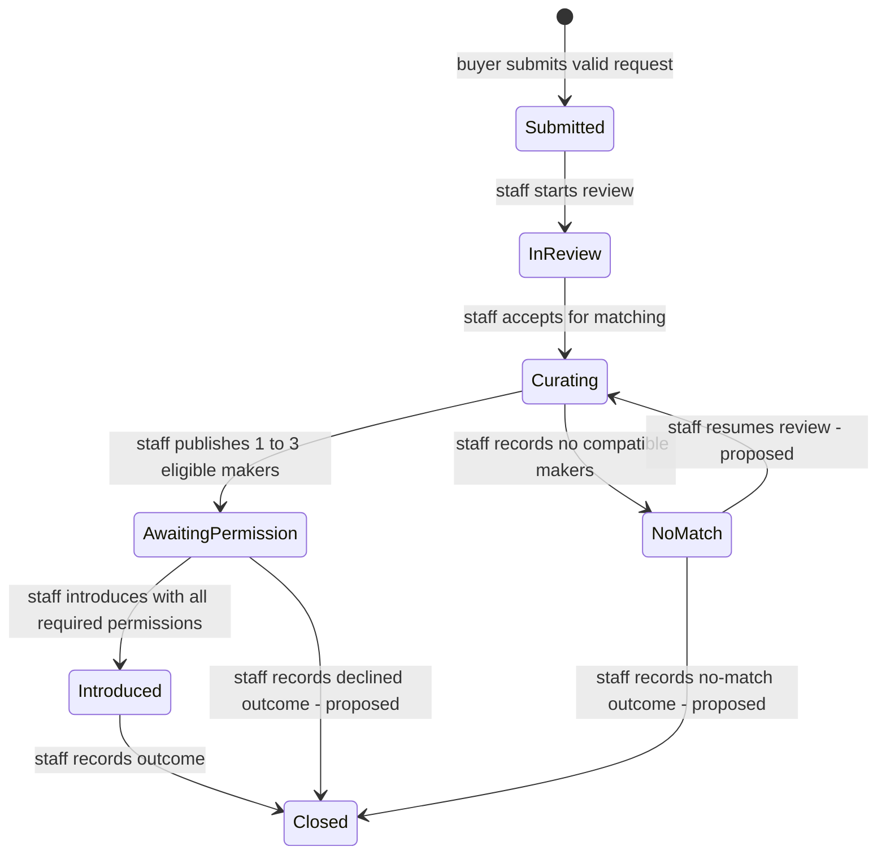
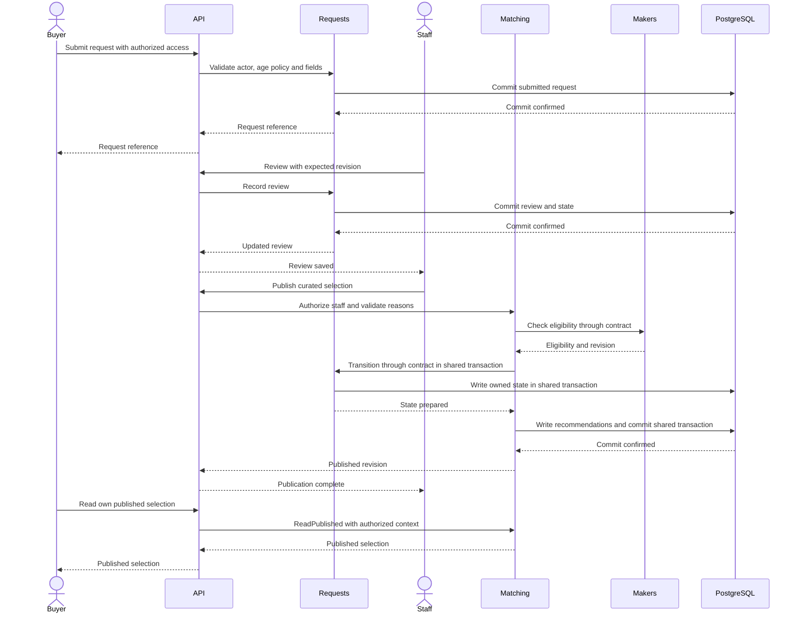

# Proposed request lifecycle

English · [Español](lifecycle.es.md)

This design develops RN-008 and RN-009 and awaits D-05. Only RF-005 exists as a demo. Persistent lifecycle states remain unimplemented.

A buyer submits a complete request. Staff review and curate it. Publication moves it to awaiting permission or no match. With every required permission, staff can introduce the parties and record an outcome. Cancellation, reopening, expiry and post-publication changes need decisions. Every transition requires an authorized actor, expected revision and atomic write. Withdrawal blocks a future introduction and preserves the history of completed actions.

Permission is recorded per recommendation and recipient. AwaitingPermission persists while valid authorization is missing. The transition to Introduced requires deciding whether one introduction is sufficient or all recommendations must be resolved, pending D-05. The diagram illustrates the proposed option of at least one valid introduction.

## Proposed critical sequence
Validation failures create no submitted request. A publication conflict rolls back both shortlist and state. Module queries use in-process contracts.

This lifecycle describes requests and introductions. Quote, order, attempt and refund have separate states in the [transactional model](commerce-model.md). Closed here does not automatically close an order.
