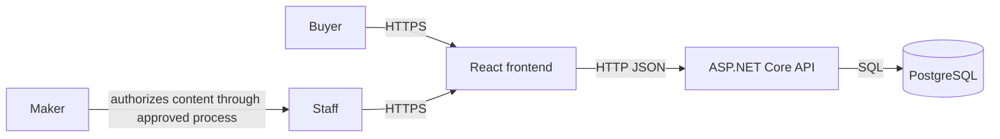
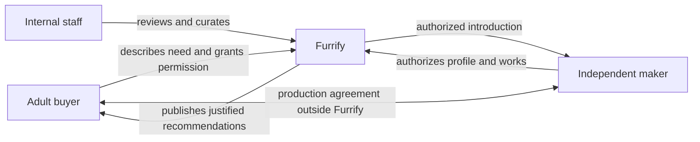
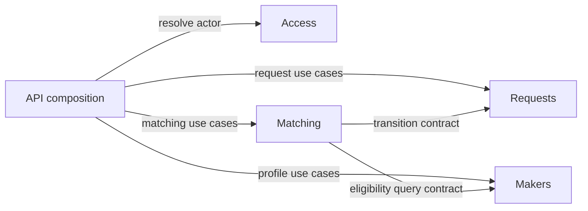
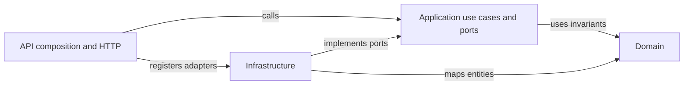
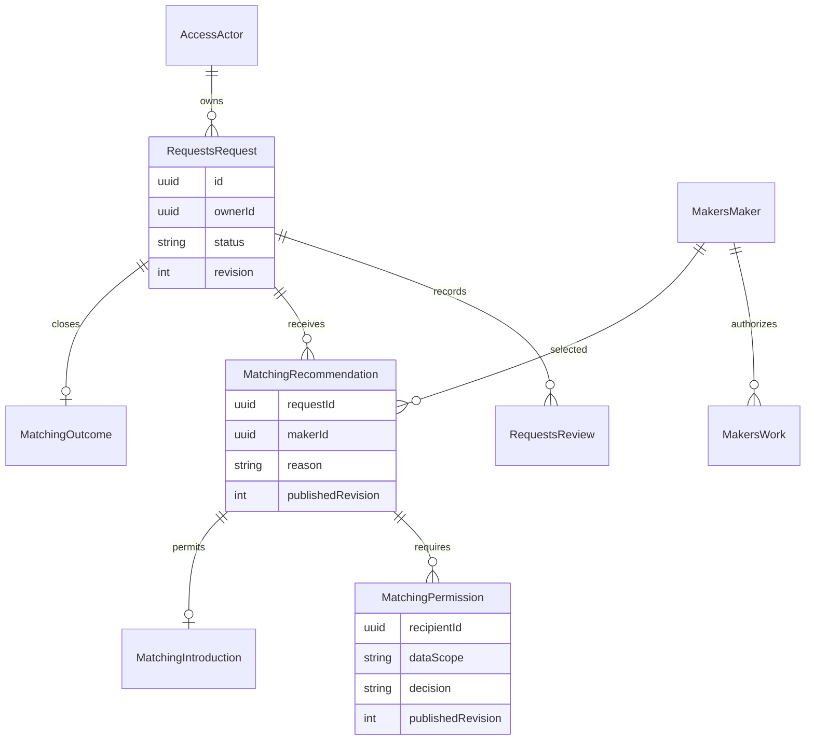

# Arquitectura actual y objetivo

[English](overview.md) · Español

## Estado actual
React, TypeScript y Vite muestran una selección ficticia. `src/main.tsx` gestiona interfaz y estados, `src/catalog.ts` normaliza códigos y devuelve fixtures asíncronos y `src/events.ts` emite eventos locales. Solo existe persistencia en memoria. Los scripts actuales verifican tipos, dominio, compilación y navegador. Los códigos de demo no son credenciales.

## Contexto y contenedores objetivo
El comprador consulta y solicita, el personal revisa y vincula y el maker autoriza su exposición. Furrify termina en la presentación y su resultado. El contrato de fabricación queda entre comprador y maker.

La pila confirmada incluye React + TypeScript + Vite, ASP.NET Core con C#, PostgreSQL, Docker y Docker Compose. El backend será un único monolito modular desplegable con Clean Architecture. Las versiones de backend y contenedores y las bibliotecas adicionales quedan pendientes.



Este diagrama describe actores y límites de ejecución objetivo. El proceso de autorización del maker no implica una cuenta de autoservicio aprobada.




## Módulos y propiedad
| Módulo | Datos propios | Operaciones y contratos |
|---|---|---|
| Makers | Perfil, obras, autorización de publicación, disponibilidad | Leer perfil autorizado y comprobar elegibilidad, mantener contenido mediante operador por definir. |
| Requests | Datos del encargo, titular, revisión, estado y revisión de concurrencia | Crear, consultar, revisar y aplicar transiciones permitidas. |
| Matching | Recomendaciones, motivos, versión publicada, permisos de contacto, presentación y resultado | Preparar, publicar, autorizar, presentar y cerrar. Consulta elegibilidad a Makers y transición a Requests. |
| Access | Identidades y permisos del personal, vínculo de acceso del comprador según D-01 | Resolver actor y permisos. Las credenciales dependen del mecanismo elegido. |

Las flechas siguientes son llamadas a contratos de aplicación dentro del mismo proceso.



Cada módulo expone contratos explícitos y oculta entidades y persistencia. Requests y Makers no dependen de Matching. Access aporta identidad a la API, que pasa un contexto de actor al caso de uso. Las consultas entre módulos no usan HTTP interno. Se prohíben escrituras y lecturas directas de tablas ajenas.

## Clean Architecture
Las flechas son dependencias de compilación. En ejecución la aplicación invoca un puerto y la implementación de infraestructura accede a PostgreSQL.



Dominio contiene entidades e invariantes RN y no depende del framework web, ORM ni PostgreSQL. Aplicación coordina casos y define puertos de persistencia y contratos entre módulos. Infraestructura implementa puertos y migraciones. API valida transporte, autentica, mapea errores y compone dependencias.

Estructura propuesta para implementación posterior, con proyectos separados donde protejan límites.

```text
frontend/                         React application, move only when useful
backend/Furrify.Api/               HTTP and composition root
backend/Modules/{Makers,Requests,Matching,Access}/
  <Module>.Domain/
  <Module>.Application/           public module contracts and ports
  <Module>.Infrastructure/
tests/                            domain, integration and end-to-end
```

Esta estructura es una propuesta. CQRS, MediatR, event sourcing, repositorios genéricos y buses requieren una necesidad posterior concreta.

## Persistencia e integridad
Se propone una base PostgreSQL con esquemas makers, requests, matching y access. Cada módulo gestiona migraciones de su esquema. Una ejecución de migraciones controlada precede a las réplicas de API y registra versiones. Probar actualización desde la versión anterior y restaurar respaldo ante migración irreversible. Las versiones de ORM y herramienta de migración siguen pendientes.

Una transacción por comando protege invariantes. Publicar actualiza selección y estado mediante contratos que comparten la unidad transaccional. El propietario Requests conserva su escritura. Si falla elegibilidad o transacción, no se publica nada. Revisiones optimistas rechazan cambios obsoletos. Claves únicas por solicitud y maker evitan duplicados. Las referencias cruzadas propuestas son FKs entre esquemas para impedir huérfanos. Esto acopla migraciones y exige orden coordinado, sin permitir acceso a tablas ajenas.

El esquema siguiente es conceptual y propuesto. Los prefijos indican propietario. Requests posee el estado, Matching posee selección y resultado. La autorización de contacto se vincula a destinatario y revisión publicada.



AccessActor representa una identidad lógica, que puede resolverse sin cuenta de comprador permanente según D-01. Un permiso por decisión conserva evidencia de aceptación o rechazo. MatchingIntroduction solo se crea tras comprobar todos los permisos requeridos, aún pendientes de política. Obras y permisos necesitan autor, fecha y evidencia de publicación.

## API y operación
Recursos HTTP propuestos, sujetos al mecanismo de acceso aprobado.

| HTTP | Resource |
|---|---|
| GET | /makers, /makers/{id}, /service |
| POST, GET | /requests, /requests/{id} |
| POST | /requests/{id}/reviews |
| PUT | /requests/{id}/recommendations |
| POST | /requests/{id}/publication |
| POST | /recommendations/{id}/permissions |
| POST | /recommendations/{id}/introductions |
| PUT | /requests/{id}/outcome |
| PUT | /makers/{id}, /makers/{id}/works/{workId} |

GET de listas de solicitudes para personal y makers necesita paginación con límite máximo configurable, orden estable y cursor o página por decidir. Separar autorización pública, de titular y de personal en cada operación. Autenticación de personal obligatoria. Proveedor y sesiones pendientes. Validar en API y aplicación, mantener invariantes en dominio. Responder 400 por entrada inválida, 401 por sesión ausente, 403 por permiso insuficiente, 404 según política de ocultación y 409 por conflicto. Usar cuerpos de error consistentes con código estable y correlación sin detalles internos.

Los reintentos de creación y presentación usarían claves de idempotencia propuestas. Una entrega externa fallida queda pendiente o fallida, nunca presentada. El canal de contacto requiere decisión D-04. No retener una transacción abierta durante entrega externa.

Health checks separados para proceso vivo y disponibilidad de base con migraciones aplicadas. Logs estructurados incluyen timestamp, nivel, evento y correlación. Excluir datos personales, referencias, secretos y tokens. Configuración validada al iniciar, secretos desde entorno o gestor del despliegue, archivos locales excluidos de Git. Respaldar base y obras si se almacenan fuera de ella, ensayar restauración y acordar RPO/RTO.

Pruebas futuras de dominio comprueban RN, integración usa PostgreSQL para FKs, migraciones, transacciones y concurrencia, API comprueba autorización y recorrido completo cubre solicitud hasta resultado. Los fixtures locales se mantienen para reproducir estados. Consultar RNF y matriz para aceptación.

## Diseño Docker
Frontend sirve distribución estática, con proxy API de mismo origen propuesto. API ejecuta el monolito y solo ella conecta a PostgreSQL por red privada de Compose. Publicar HTTP del frontend y API según proxy y entorno. PostgreSQL queda interno. Un volumen nombrado para su directorio de datos conserva registros al recrear contenedor. Eliminar volúmenes es una operación distinta y destructiva.

Variables propuestas incluyen URL pública, conexión de base, credenciales de base y configuración de identidad. Las variables Vite son públicas al compilar y no deben contener secretos. Arranque requiere base disponible, migraciones aplicadas y API ready antes de servir operaciones. El orden de arranque solo no garantiza disponibilidad. Desarrollo puede montar fuentes y habilitar recarga. Despliegue usa imágenes inmutables, TLS y secretos gestionados. Versiones de imágenes, almacenamiento de obras y plataforma pendientes. Esta tarea solo documenta el diseño.

## Transición
Aprobar primero acceso, edad y consentimiento. Implementar luego módulos y persistencia con migraciones y pruebas de autorización, sustituir adaptador local por HTTP sin perder estados de UI y finalmente preparar contenedores y ensayo de restauración. Preservar el recorrido ficticio como fixture. El backend, base y contenedores aún están por crear. Consultar [decisiones](../humans/decisions.es.md) y [ciclo de vida](lifecycle.es.md).
