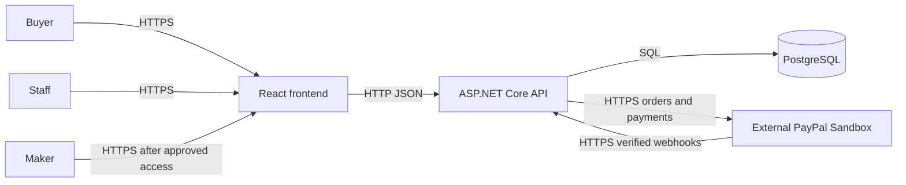
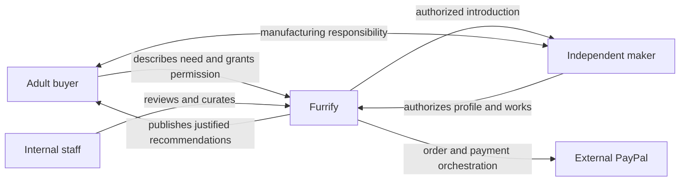
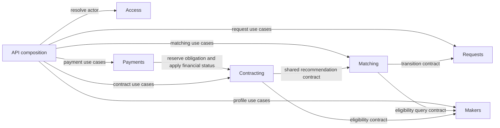
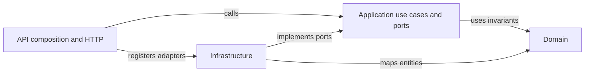
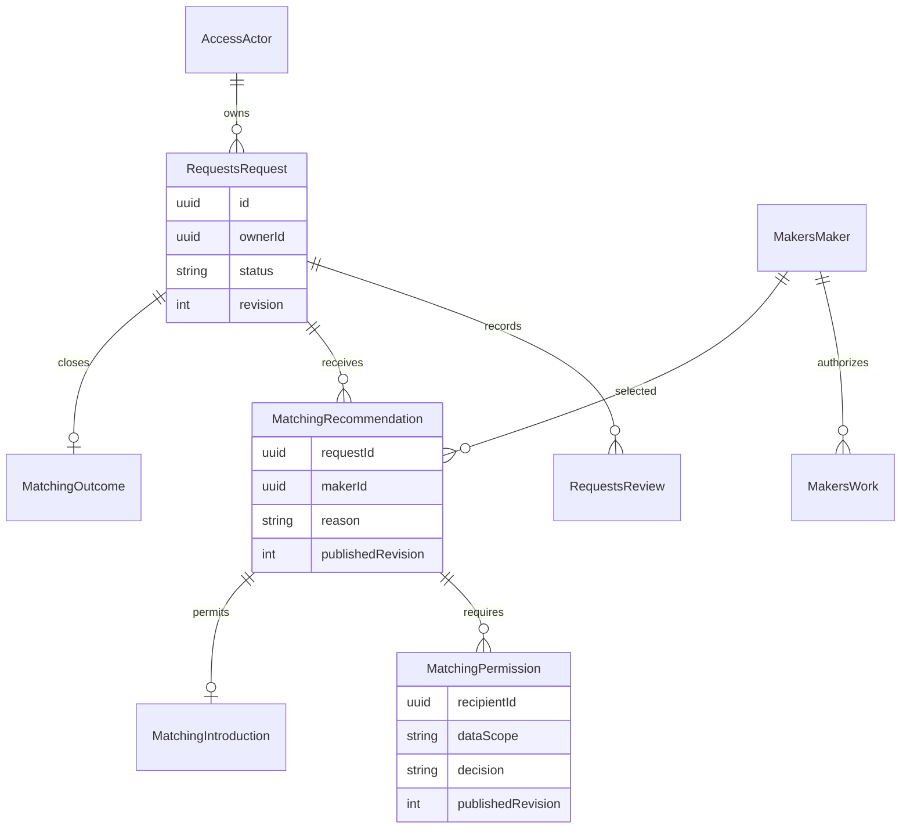

# Arquitectura actual y objetivo

[English](overview.md) · Español

## Estado actual
React, TypeScript y Vite muestran una selección ficticia. `src/main.tsx` gestiona interfaz y estados, `src/catalog.ts` normaliza códigos y devuelve fixtures asíncronos y `src/events.ts` emite eventos locales. Solo existe persistencia en memoria. Los scripts actuales verifican tipos, dominio, compilación y navegador. Los códigos de demo no son credenciales.

## Contexto y contenedores objetivo
El comprador consulta y solicita, el personal revisa y vincula y el maker autoriza su exposición. El objetivo transaccional incluye aceptación de cotización, pedidos, pagos, devoluciones e incidencias. Comprador y maker siguen siendo contrapartes de fabricación.

La pila confirmada incluye React + TypeScript + Vite, ASP.NET Core con C#, PostgreSQL, Docker y Docker Compose. El backend será un único monolito modular desplegable con Clean Architecture. Las versiones de backend y contenedores y las bibliotecas adicionales quedan pendientes.



Este diagrama describe actores y límites de ejecución objetivo. El proceso de autorización del maker no implica una cuenta de autoservicio aprobada.




## Módulos y propiedad
| Módulo | Datos propios | Operaciones y contratos |
|---|---|---|
| Makers | Perfil, obras, autorización de publicación, disponibilidad | Leer perfil autorizado y comprobar elegibilidad, mantener contenido mediante operador por definir. |
| Requests | Datos del encargo, titular, revisión, estado y revisión de concurrencia | Crear, consultar, revisar y aplicar transiciones permitidas. |
| Matching | Recomendaciones, motivos, versión publicada, permisos de contacto, presentación y resultado | Preparar, publicar, autorizar, presentar y cerrar. Consulta elegibilidad a Makers y transición a Requests. |
| Access | Identidades y permisos del personal, vínculo de acceso del comprador según D-01 | Resolver actor y permisos. Las credenciales dependen del mecanismo elegido. |

Las flechas siguientes son llamadas a contratos de aplicación dentro del mismo proceso.



Cada módulo expone contratos explícitos y oculta entidades y persistencia. Requests y Makers no dependen de Matching. Access aporta identidad a la API, que pasa un contexto de actor al caso de uso. Las consultas entre módulos no usan HTTP interno. Se prohíben escrituras y lecturas directas de tablas ajenas.


## Ampliación de módulos

| Module | Owned capability | Boundary |
|---|---|---|
| Contracting | Cotizaciones, revisiones, aceptaciones, pedidos, obligaciones e incidencias. | Emite oferta, congela condiciones y coordina aceptación/pedido. Expone ReadAgreement, ReservePayableObligation y ApplyFinancialStatus. No llama a PayPal ni escribe tablas de pagos. |
| Payments | Intentos, capturas, devoluciones, inbox y operaciones durables. | Expone Start, Capture, Reconcile y Refund. Solo este módulo integra proveedor externo. No cambia condiciones comerciales ni fabrica. |

## Clean Architecture
Las flechas son dependencias de compilación. En ejecución la aplicación invoca un puerto y la implementación de infraestructura accede a PostgreSQL.



Dominio contiene entidades e invariantes RN y no depende del framework web, ORM, PostgreSQL ni PayPal. Aplicación coordina casos y define puertos de persistencia y contratos entre módulos. Infraestructura implementa puertos y migraciones. API valida transporte, autentica, mapea errores y compone dependencias.

Estructura propuesta para implementación posterior, con proyectos separados donde protejan límites.

```text
frontend/                         React application, move only when useful
backend/Furrify.Api/               HTTP and composition root
backend/Modules/{Makers,Requests,Matching,Access,Contracting,Payments}/
  <Module>.Domain/
  <Module>.Application/           public module contracts and ports
  <Module>.Infrastructure/
tests/                            domain, integration and end-to-end
```

Esta estructura es una propuesta. CQRS, MediatR, event sourcing, repositorios genéricos y buses requieren una necesidad posterior concreta.

## Persistencia e integridad
Se propone una base PostgreSQL con esquemas makers, requests, matching y access. Cada módulo gestiona migraciones de su esquema. Una ejecución de migraciones controlada precede a las réplicas de API y registra versiones. Probar actualización desde la versión anterior y restaurar respaldo ante migración irreversible. Las versiones de ORM y herramienta de migración siguen pendientes.

Una transacción por comando protege invariantes. Publicar actualiza selección y estado mediante contratos que comparten la unidad transaccional. El propietario Requests conserva su escritura. Si falla elegibilidad o transacción, no se publica nada. Revisiones optimistas rechazan cambios obsoletos. Claves únicas por solicitud y maker evitan duplicados. Las referencias cruzadas propuestas son FKs entre esquemas para impedir huérfanos. Esto acopla migraciones y exige orden coordinado, sin permitir acceso a tablas ajenas.

El esquema siguiente es conceptual y propuesto. Los prefijos indican propietario. Requests posee el estado, Matching posee selección y resultado. La autorización de contacto se vincula a destinatario y revisión publicada.



AccessActor representa una identidad lógica, que puede resolverse sin cuenta de comprador permanente según D-01. Un permiso por decisión conserva evidencia de aceptación o rechazo. MatchingIntroduction solo se crea tras comprobar todos los permisos requeridos, aún pendientes de política. Obras y permisos necesitan autor, fecha y evidencia de publicación.

## API y operación

La fuente de contratos HTTP y paginación es [contratos](contracts.es.md). El modelo lógico y estados se centralizan en [modelo transaccional](commerce-model.es.md). Los diagramas de este documento describen límites, no reemplazan esos contratos.

## Diseño Docker
Frontend sirve distribución estática, con proxy API de mismo origen propuesto. API ejecuta el monolito y solo ella conecta a PostgreSQL por red privada de Compose. Publicar HTTP del frontend y API según proxy y entorno. PostgreSQL queda interno. Un volumen nombrado para su directorio de datos conserva registros al recrear contenedor. Eliminar volúmenes es una operación distinta y destructiva.

Variables propuestas incluyen URL pública, conexión de base, credenciales de base y configuración de identidad. Las variables Vite son públicas al compilar y no deben contener secretos. Arranque requiere base disponible, migraciones aplicadas y API ready antes de servir operaciones. El orden de arranque solo no garantiza disponibilidad. Desarrollo puede montar fuentes y habilitar recarga. Despliegue usa imágenes inmutables, TLS y secretos gestionados. Versiones de imágenes, almacenamiento de obras y plataforma pendientes. Esta tarea solo documenta el diseño.

## Transición
Aprobar primero acceso, edad y consentimiento. Implementar luego módulos y persistencia con migraciones y pruebas de autorización, sustituir adaptador local por HTTP sin perder estados de UI y finalmente preparar contenedores y ensayo de restauración. Preservar el recorrido ficticio como fixture. El backend, base y contenedores aún están por crear. Consultar [decisiones](../humans/decisions.es.md) y [ciclo de vida](lifecycle.es.md).

## Contratos de compilación

Cada Application expone solo contratos DTO y puertos públicos en carpeta Contracts, con implementaciones internas. Application referencia su Domain y Contracts de Application de módulos permitidos. Infrastructure referencia Application y Domain propios. API es raíz de composición y referencia aplicaciones e infraestructuras para registrar adaptadores. Domain no referencia otros módulos. Acceso al módulo se resuelve por DI, no mediante entidades públicas ni contextos de datos compartidos. No hay dependencia Contracting → Payments, evitando ciclo.

## Operación transaccional

PayPal es externo, nunca un servicio Compose. En pruebas configurar URL HTTPS alcanzable hacia /api/v1/webhooks/paypal, con herramienta de exposición a elección y app Sandbox correcta. Producción usa dominio HTTPS estable y proxy con preservación del cuerpo/headers de webhook. Puerto público propuesto 443, HTTP local de desarrollo configurable, PostgreSQL sin puerto público en despliegue. API escucha puerto interno configurable. Secretos PayPal nunca se compilan en Vite.

Reinicio API reanuda Operations e Inbox por lease, readiness comprueba base y migraciones; disponibilidad PayPal se informa degradada sin reiniciar ni negar lecturas innecesariamente. Migraciones en paso único previo, compatibilidad entre versión API y esquema. Respaldos incluyen DB, autorizaciones y almacenamiento de obras, cifrados con acceso separado. Restaurar exige comprobar obligaciones, capturas y devoluciones contra proveedor antes de habilitar nuevos cobros. Retención, RPO/RTO y frecuencia pendientes.

Eventos propuestos son quote.issued, quote.accepted, order.created, payment.intent_saved, payment.pending, payment.unknown, payment.verified, payment.quarantined, webhook.received, webhook.verified, reconciliation.completed y refund.completed. Campos permitidos son timestamp, level, event, correlationId, operationId, orderId e IDs internos de intento/refund. No registrar cuerpos, términos, PII ni tokens. Correlación enlaza HTTP, worker e inbox, manteniendo IDs proveedor solo en evidencia restringida.

[Model](commerce-model.es.md) · [Contracts and screens](contracts.es.md) · [Payments](payments.es.md) · [Test strategy](../humans/testing-strategy.es.md).
