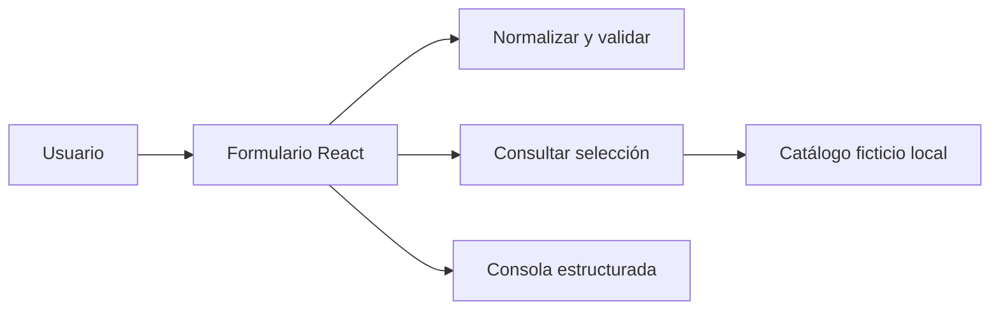

# Arquitectura actual

[English](overview.md) · Español

Vite sirve una página React escrita en TypeScript. El navegador conserva el código y el resultado en memoria mientras la página está abierta.

`src/main.tsx` gobierna los estados inicial, inválido, carga, vacío, éxito y error. Deshabilita la consulta mientras está en curso. `src/catalog.ts` valida el formato y devuelve una promesa con una lista de makers (nombre, especialidad y motivo). La demora fija hace observable la carga. La interfaz conoce el contrato del adaptador. El adaptador es independiente de React.

`src/events.ts` registra transiciones y fallos locales. Una consulta fallida mantiene el formulario disponible. Los listeners globales observan excepciones y promesas rechazadas. El código de consulta sirve solo para navegar por la simulación. Cualquier visitante puede inspeccionar los datos distribuidos con la página. Cargar datos reales requeriría control de acceso en servidor, consentimiento y reglas de retención.

## Evolución propuesta
Cuando se defina el acceso al piloto, se podría sustituir la lectura local por un cliente HTTP contra ASP.NET Core y guardar solicitudes y autorizaciones en PostgreSQL. La autorización, el límite de tres y la trazabilidad del consentimiento corresponderían al servidor. [Decisión vigente](decisions/001-consulta-local.es.md).
