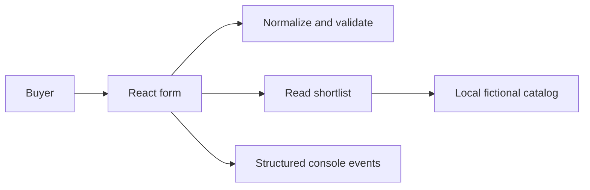

# Current architecture

English · [Español](overview.es.md)

Vite serves a React page written in TypeScript. The browser keeps the entered code and lookup result in memory while the page is open.

`src/main.tsx` manages idle, invalid, loading, empty, success and error states. It disables the form during a lookup. `src/catalog.ts` validates the code format and asynchronously returns makers with a name, specialty and reason. A fixed delay makes loading observable. The UI depends on the adapter contract. The adapter can run independently of React.

`src/events.ts` records transitions and failures locally. After a failed lookup the buyer can use the form again. Global listeners observe runtime exceptions and unhandled promise rejections. Lookup codes select demo scenarios. Any visitor can inspect the data shipped with the page. Real information would require server-side access control, consent and retention rules.

## Possible evolution

Once pilot access rules are defined, an HTTP client could call an ASP.NET Core backend and PostgreSQL could store requests and permissions. The server would enforce authorization and the three-maker limit, and track consent. [Current decision](decisions/001-consulta-local.md).
