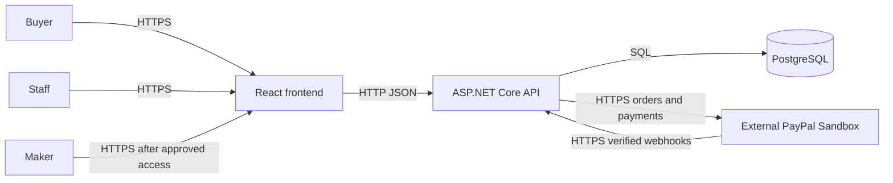
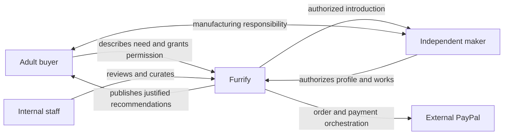
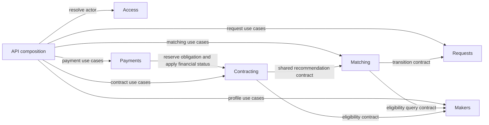
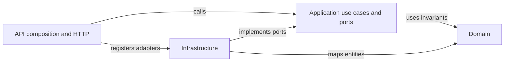
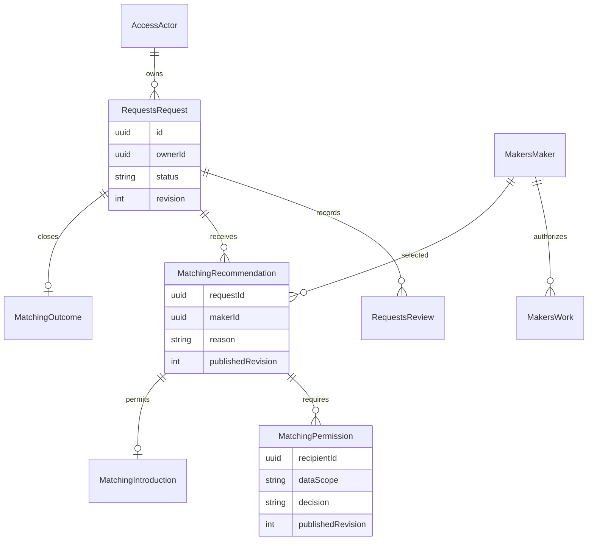

# Current and target architecture

English · [Español](overview.es.md)

## Current state
React, TypeScript and Vite display a fictional shortlist. `src/main.tsx` handles UI states, `src/catalog.ts` normalizes codes and reads asynchronous fixtures, and `src/events.ts` emits local events. State lives in memory. Existing scripts check types, domain behavior, build and browser flows. Demo codes are not credentials.

## Target context and containers
Buyers browse and submit, staff review and introduce, and makers authorize their public content. The transactional target includes quote acceptance, orders, payments, refunds and incidents. Buyer and maker remain the production counterparties.

The confirmed stack is React + TypeScript + Vite, ASP.NET Core with C#, PostgreSQL, Docker and Docker Compose. One modular monolith backend applies Clean Architecture. Backend and container versions and additional libraries remain pending.



This diagram describes target actors and runtime boundaries. Maker authorization does not imply an approved self-service account.




## Modules and ownership
| Module | Owned data | Operations and contracts |
|---|---|---|
| Makers | Profile, works, publication permissions, availability | Read authorized profile, check eligibility and maintain content through an operator to be decided. |
| Requests | Buyer request, owner, review, status and concurrency revision | Create, read, review and apply allowed transitions. |
| Matching | Recommendations, reasons, published revision, contact permissions, introduction and outcome | Curate, publish, authorize, introduce and close. Ask Makers for eligibility and Requests for transitions. |
| Access | Staff identities and permissions, buyer access binding according to D-01 | Resolve actor and permissions. Credentials depend on the selected mechanism. |

The following arrows represent in-process application contract calls.



Each module exposes explicit contracts and hides entities and persistence. Requests and Makers do not depend on Matching. Access supplies identity to the API, which passes actor context to the use case. Module calls stay in process. Direct reads and writes to another module's tables are prohibited.


## Module extension

| Module | Owned capability | Boundary |
|---|---|---|
| Contracting | Quotes, revisions, acceptances, orders, obligations and incidents. | Issues offers, freezes terms and coordinates acceptance/order. Exposes ReadAgreement, ReservePayableObligation and ApplyFinancialStatus. Does not call PayPal or write payment tables. |
| Payments | Attempts, captures, refunds, inbox and durable operations. | Exposes Start, Capture, Reconcile and Refund. Only this module integrates external payment providers. Does not change commercial terms or manufacture. |

## Clean Architecture
Arrows represent compile-time dependencies. At runtime, application code invokes a port whose infrastructure implementation accesses PostgreSQL.



Domain contains entities and business invariants with no web framework, ORM, PostgreSQL or PayPal dependencies. Application coordinates use cases and defines persistence ports and module contracts. Infrastructure implements ports and migrations. API validates transport, authenticates, maps errors and composes dependencies.

Proposed structure for later implementation, using separate projects where they protect boundaries.

```text
frontend/                         React application, move only when useful
backend/Furrify.Api/               HTTP and composition root
backend/Modules/{Makers,Requests,Matching,Access,Contracting,Payments}/
  <Module>.Domain/
  <Module>.Application/           public module contracts and ports
  <Module>.Infrastructure/
tests/                            domain, integration and end-to-end
```

This structure is a proposal. CQRS, MediatR, event sourcing, generic repositories and buses require a later concrete need.

## Persistence and integrity
One PostgreSQL database with makers, requests, matching and access schemas is proposed. Each module owns schema migrations. A controlled migration step runs before API replicas and records versions. Test upgrades from the previous release and restore a backup after an irreversible migration. ORM and migration tool choices remain pending.

One transaction per command protects invariants. Publication updates the shortlist and request state through contracts sharing a transaction scope. Requests retains ownership of its writes. Failed eligibility or transactions publish nothing. Optimistic revisions reject stale updates. Unique request-maker keys prevent duplicates. Proposed cross-schema foreign keys prevent orphan references. They couple migration ordering and require coordination while preserving table ownership.

The following conceptual model is proposed. Prefixes identify owners. Requests owns status, Matching owns recommendations and outcomes. Contact permission binds a recipient and published revision.



AccessActor is a logical identity which may be resolved without a permanent buyer account under D-01. Each permission decision preserves evidence of grant or refusal. MatchingIntroduction is created only after all policy-required permissions are checked. Works and publication permissions need author, time and evidence.

## API and operation

HTTP contracts and pagination are authoritative in [contracts](contracts.md). Logical model and states are centralized in [transactional model](commerce-model.md). Diagrams here describe boundaries rather than replace those contracts.

## Docker design
The frontend container serves static assets, with a proposed same-origin API proxy. The API container runs the monolith and alone connects to PostgreSQL over a private Compose network. Publish frontend/API HTTP according to the proxy and environment. PostgreSQL stays internal. A named volume for its data directory preserves records when recreating the container. Removing volumes is a separate destructive operation.

Proposed variables include public URL, database connection, database credentials and identity settings. Vite build variables are public and must exclude secrets. Startup requires database readiness, applied migrations and API readiness before serving operations. Startup ordering alone does not guarantee readiness. Development may mount source and use reload. Deployment uses immutable images, TLS and managed secrets. Image versions, media storage and deployment platform remain pending. This task documents the design only.

## Transition
Approve access, age and consent policies first. Then implement modules and persistence with migrations and authorization tests, replace the local adapter with HTTP while preserving UI states, and prepare containers and restore exercises. Preserve the fictional journey as fixtures. Backend, database and containers remain unimplemented. See [decisions](../humans/decisions.md) and [lifecycle](lifecycle.md).

## Compile-time contracts

Each Application exposes only public DTO contracts and ports in a Contracts folder with internal implementations. Application references its own Domain and permitted modules’ Application Contracts. Infrastructure references its own Application and Domain. API is composition root and references applications/infrastructure for adapter registration. Domain references no other modules. DI resolves module contracts without public entities or shared data contexts. There is no Contracting → Payments dependency, avoiding a cycle.

## Transactional operation

PayPal is external, never a Compose service. Tests configure reachable HTTPS at /api/v1/webhooks/paypal using a chosen exposure tool and correct Sandbox app. Deployment uses a stable HTTPS domain and proxy preserving webhook body/headers. Proposed public port is 443, local development HTTP is configurable, PostgreSQL has no public deployment port. API listens on a configurable internal port. PayPal secrets are never compiled into Vite.

API restart resumes Operations and Inbox by lease. Readiness checks database/migrations; PayPal unavailability reports degraded external capability without restarting or unnecessarily blocking reads. Migrations run once before API rollout, with API/schema compatibility. Backups include DB, permissions and media storage, encrypted with separate access. Restore requires checking obligations, captures and refunds against the provider before enabling new charging. Retention, RPO/RTO and frequency remain pending.

Proposed events are quote.issued, quote.accepted, order.created, payment.intent_saved, payment.pending, payment.unknown, payment.verified, payment.quarantined, webhook.received, webhook.verified, reconciliation.completed and refund.completed. Allowed fields are timestamp, level, event, correlationId, operationId, orderId and internal attempt/refund IDs. Exclude bodies, terms, PII and tokens. Correlation links HTTP, workers and inbox, keeping provider IDs in restricted evidence only.

[Model](commerce-model.md) · [Contracts and screens](contracts.md) · [Payments](payments.md) · [Test strategy](../humans/testing-strategy.md).
