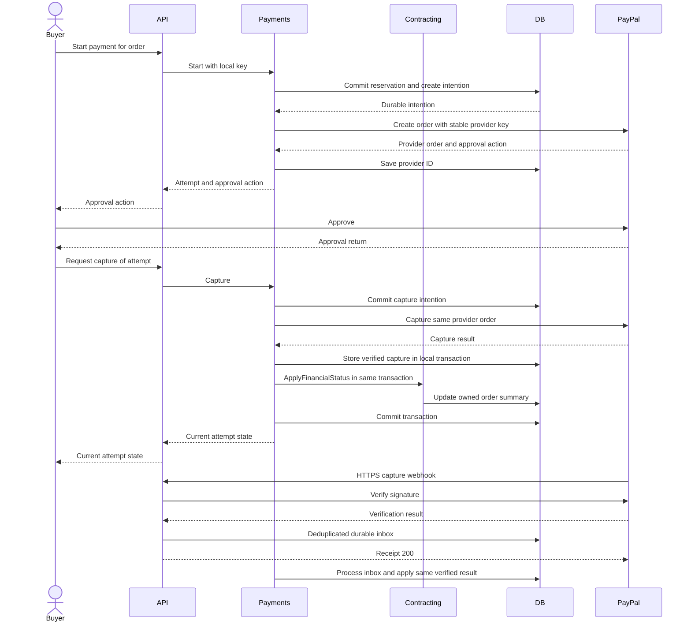
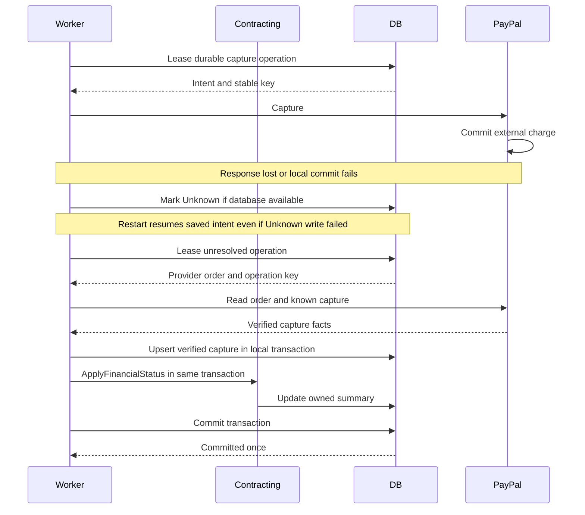

# Diseño de pagos

[English](payments.md) · Español

Diseño objetivo propuesto, sin integración implementada ni ejecución Sandbox. RF-017–021 y RN-015–018 definen la aceptación. Los importes y el receptor los determina el backend a partir del pedido aceptado. El retorno del navegador y la aprobación del comprador no confirman cobro.

## Modelo comercial por aprobar
| Modelo | Incorporación y permisos | Datos y operación |
|---|---|---|
| A. Maker recibe, sin comisión | Validar incorporación y permisos para operar por cada vendedor. | Cuenta receptora autorizada vinculada al maker, pedido de un vendedor, conciliación por receptor. |
| B. Maker recibe, comisión de plataforma | Requiere capacidades y habilitación multiparty, además de onboarding. | Añade comisión, reglas de devolución de comisión y contabilidad correspondiente. |
| C. Furrify recibe y transfiere | Requiere evaluación comercial y habilitación de cobros y desembolsos. | Añade obligaciones de liquidación, saldos, fallos de transferencia y conciliación de dos movimientos. |

Recomendación para validar primero es A, con un maker por pedido y sin comisión de plataforma. Es una base reversible de Sandbox, pendiente de D-08. B cambia instrucciones de comisión. C requiere diseño adicional de liquidación antes de implementación. No se propone custodia indefinida ni escrow. No se presupone que cualquier cuenta pueda operar en nombre de otros vendedores.

## Fuentes oficiales y grado de certeza
Revisadas el 18 de noviembre de 2026. Capacidades documentadas no equivalen a validación del adaptador de Furrify.

| Documentado | Validación pendiente |
|---|---|
| Orders v2 permite crear, consultar y capturar órdenes. [Orders](https://developer.paypal.com/api/orders/v2) | Probar creación, aprobación y captura con vendedor y comprador Sandbox configurados. |
| Payments v2 permite consultar captura, devolver y consultar devolución. [Payments](https://developer.paypal.com/api/payments/v2) | Probar importes admitidos, estados y permisos efectivos de devolución. |
| Webhooks HTTPS y verificación mediante firma o endpoint del proveedor. [Webhooks](https://developer.paypal.com/api/rest/webhooks/) | Comprobar entrega real de la aplicación Sandbox y webhook ID correcto. |
| PayPal-Request-Id ofrece idempotencia en operaciones compatibles durante la retención del proveedor. [Idempotency](https://developer.paypal.com/api/rest/reference/idempotency/) | Verificar soporte y retención por operación antes de fijar ventanas de reintento. |
| Plataformas requieren aprobación para credenciales live. [Platforms](https://developer.paypal.com/platforms/overview/) | Onboarding, países, monedas, permisos y modelo comercial para producción. |

## Puertos y responsabilidades
Payments.Application define PaymentGateway con CreateOrder(intent), ReadOrder(providerOrderId), Capture(intent), ReadCapture(captureId), Refund(intent), ReadRefund(refundId) y VerifyWebhook(headers, rawBody, webhookId). Devuelve datos normalizados, ID proveedor, estado conocido o incierto y códigos de fallo seguros. Dominio no conoce PayPal. Infraestructura mapea REST, OAuth, estados y errores. Contrato interno PaymentStatus(orderId) entrega resumen al módulo Contracting. Payments orquesta la actualización de Contracting mediante su contrato ApplyFinancialStatus, sin dependencia inversa.

Frontend solicita intento al backend y presenta aprobación mediante mecanismo PayPal elegido. El client ID puede ser público. Solo backend conserva client secret, access token y credenciales delegadas. Configuración separada Sandbox/live con API base, webhook ID, cuenta receptora autorizada y URL pública. Impedir mezcla de ambientes y validar configuración al arrancar.

## Protocolo propuesto
1. Transacción local reserva obligación del pedido y crea PaymentAttempt con importe, moneda, receptor, clave local, hash de petición y operación Create. Un índice impide varios intentos activos por obligación.
2. Tras commit, adaptador crea orden PayPal con intención CAPTURE. Guarda providerOrderId único por entorno y receptor. Un timeout pasa a Unknown y mantiene la reserva.
3. El comprador aprueba fuera de Furrify. Backend recibe solicitud de captura vinculada al intento, nunca importe ni receptor editables.
4. Antes de capturar, comprueba titular, pedido, orden proveedor y reserva. Persiste CaptureOperation y clave PayPal estable antes de salir a red.
5. Respuesta autenticada o consulta verificada con captura COMPLETED, misma orden, importe, moneda y receptor permite guardar Capture y marcar obligación satisfecha. Estado PENDING conserva espera. Rechazo explícito permite liberar intento cuando se descarte cobro.
6. La escritura de Capture y ApplyFinancialStatus ocurre en una transacción PostgreSQL por contratos. Pago y estado financiero del pedido permanecen consistentes. Un worker reanuda intenciones pendientes.

Una captura COMPLETED es necesaria pero no suficiente si hay discrepancia de correspondencia. Order COMPLETED sin captura comprobada no basta. Se preserva la evidencia mínima de estado y referencia sin payload completo en logs. Pérdida de respuesta no autoriza crear otra captura.

## Webhooks y conciliación
Propuesta de verificación remota mediante /v1/notifications/verify-webhook-signature usando cuerpo original, headers de transmisión y webhook ID configurado. Aceptar únicamente SUCCESS del verificador. El endpoint no usa sesión de comprador. Limitar tamaño, validar esquema y excluir cualquier URL arbitraria de certificado suministrada por el cliente de descargas propias.

Tras autenticidad, guardar inbox único por ambiente/app/event ID antes de responder 2xx. Un duplicado ya guardado recibe 200. Si no puede verificarse por indisponibilidad, responder 503. Firma inválida recibe 400 y no cambia negocio. Si falla persistencia, devolver 503. Un evento auténtico desconocido se guarda para diagnóstico restringido. El procesamiento transaccional consulta el recurso proveedor cuando el evento sea incompleto o contradictorio.

Inbox aporta deduplicación y recuperación tras recepción. Cuesta almacenamiento, worker y políticas de retención. Una tabla Operation con estado, nextAttemptAt, lease y contador sirve de cola durable para trabajo saliente y conciliación. No se necesita bus externo. Reintentos con límite y backoff propuesto, luego revisión humana. El worker usa lease con vencimiento y versión para evitar ejecución concurrente. Nunca mantiene transacción abierta durante HTTP.

Consultar orden y captura conocida para resolver Unknown. Reutilizar clave PayPal solo dentro de soporte validado. Si la creación quedó incierta sin ID recuperable y pasó la ventana del proveedor, bloquear nuevo cobro y escalar revisión. Conciliación por webhook, respuesta o polling converge por IDs únicos y la misma función de aplicación de resultado. No existe transacción distribuida.

## Matriz de fallos
| Caso | Estado y recuperación |
|---|---|
| Abandono/cancelación del navegador | Registrar abandono informativo, consultar proveedor antes de liberar reserva. No equivale a cancelación del pedido. |
| Rechazo o pendiente | Declined permite nuevo intento solo tras resultado terminal comprobado. Pending mantiene reserva y muestra espera. |
| Doble clic o concurrencia | Misma clave local y payload devuelve recurso existente. Payload diferente con la misma clave produce 409. Nueva clave durante intento activo devuelve el intento actual o 409. |
| Captura con timeout | Unknown, conservar clave y consultar. No reenviar con clave nueva. |
| Proveedor cobró y commit falló | Intención previa permite worker o webhook recuperar Capture y aplicar pedido una sola vez. |
| Evento repetido/fuera de orden | Inbox deduplica; consultar estado actual, no retroceder de Captured por evento Approved antiguo. Refund y reversal son hechos separados. |
| Importe/moneda/receptor incorrectos | Quarantined, pedido sin marcar pagado, alerta y conciliación humana. |
| Refund mientras captura está incierta | 409 o solicitud pendiente sin ejecución. Conciliar primero. |
| Reversión/disputa externa | Conservar captura original y registrar incidente, bloquear nuevo cierre financiero hasta revisión. Política en D-10. |

## Reembolsos
El comprador solicita revisión, el actor aprobado autoriza y solo backend ejecuta. Reservar importe reembolsable en transacción para impedir sobredevolución concurrente. Suma de completados más pendientes no supera captura. Una intención durable precede al POST /v2/payments/captures/{id}/refund. Guardar refundId, consultar /v2/payments/refunds/{id} cuando el resultado sea incierto. Completar solo con estado verificado. Fallo libera reserva únicamente tras descartar ejecución externa. Devolución parcial no cancela automáticamente el pedido. Política de anticipos, comisiones, cancelación y devolución pendiente.

## Antes de producción
Validar modelo receptor y permisos comerciales, onboarding real, restricciones de país/moneda, credenciales live, suscripción HTTPS de la app correcta, controles de acceso y secretos, restauración y conciliación operativa. Probar flujos y fallos autorizados, revisar privacidad y responsabilidades y acordar soporte de incidencias. Sandbox aprobado no demuestra habilitación live. [Decisiones](../humans/decisions.es.md).

## Secuencias propuestas

