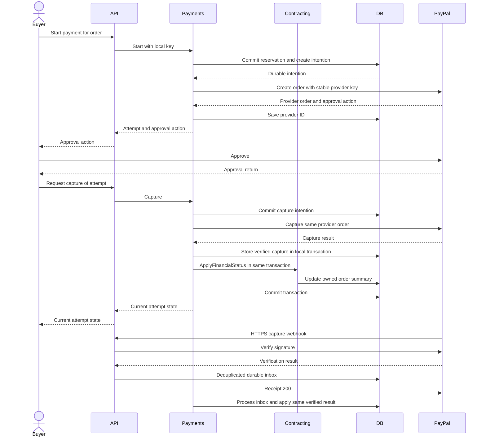
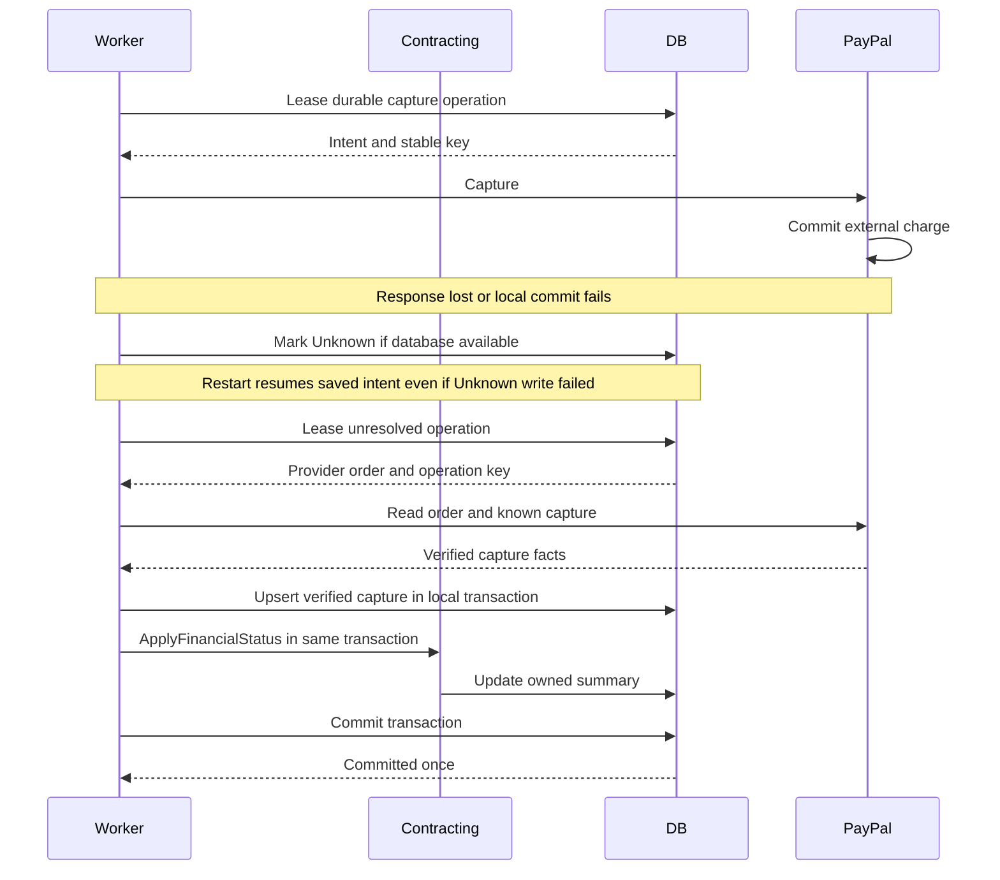

# Payment design

English · [Español](payments.es.md)

Proposed target design. No adapter implementation or Sandbox execution exists. RF-017–021 and RN-015–018 define acceptance. The backend derives amounts and recipient from the accepted order. Browser return and buyer approval do not confirm payment.

## Commercial model awaiting approval
| Model | Onboarding and permissions | Data and operation |
|---|---|---|
| A. Maker receives, no platform fee | Validate onboarding and permission to act for each seller. | Authorized recipient account bound to maker, single-seller order, recipient reconciliation. |
| B. Maker receives, platform fee | Requires multiparty capabilities and enablement plus onboarding. | Adds fee rules, fee refunds and corresponding accounting. |
| C. Furrify receives and transfers | Requires commercial assessment and collection/disbursement enablement. | Adds settlement obligations, balances, transfer failures and reconciliation of two movements. |

Recommend validating A first with one maker per order and no platform fee. This is a reversible Sandbox baseline pending D-08. B changes fee instructions. C needs additional settlement design before implementation. Indefinite custody or escrow is outside this proposal. Acting for arbitrary sellers is not assumed available.

## Official sources and certainty
Reviewed November 18, 2026. Documented capabilities do not establish validation of Furrify's adapter.

| Documented | Validation pending |
|---|---|
| Orders v2 supports creating, reading and capturing orders. [Orders](https://developer.paypal.com/api/orders/v2) | Test creation, approval and capture with configured Sandbox seller and buyer. |
| Payments v2 supports capture lookup, refund and refund lookup. [Payments](https://developer.paypal.com/api/payments/v2) | Test supported amounts, states and effective refund permissions. |
| HTTPS webhooks and verification through signatures or provider endpoint. [Webhooks](https://developer.paypal.com/api/rest/webhooks/) | Check real delivery from the Sandbox application and correct webhook ID. |
| PayPal-Request-Id provides idempotency for supported operations within provider retention. [Idempotency](https://developer.paypal.com/api/rest/reference/idempotency/) | Verify support and retention per operation before fixing retry windows. |
| Platforms require approval for live credentials. [Platforms](https://developer.paypal.com/platforms/overview/) | Onboarding, countries, currencies, permissions and commercial model for production. |

## Ports and responsibilities
Payments.Application defines PaymentGateway with CreateOrder(intent), ReadOrder(providerOrderId), Capture(intent), ReadCapture(captureId), Refund(intent), ReadRefund(refundId) and VerifyWebhook(headers, rawBody, webhookId). It returns normalized data, provider ID, known or uncertain status and safe error codes. Domain has no PayPal knowledge. Infrastructure maps REST, OAuth, states and errors. Internal PaymentStatus(orderId) supplies a summary to Contracting. Payments orchestrates Contracting updates through ApplyFinancialStatus, avoiding a reverse dependency.

Frontend asks the backend for an attempt and presents approval through the chosen PayPal mechanism. Client ID may be public. Only backend retains client secret, access token and delegated credentials. Sandbox/live configuration separates API base, webhook ID, authorized recipient and public URL. Reject mixed environments and validate settings at startup.

## Proposed protocol
1. A local transaction reserves the order obligation and creates PaymentAttempt with amount, currency, recipient, local key, request hash and Create operation. An index prevents multiple active attempts per obligation.
2. After commit, the adapter creates a PayPal order with CAPTURE intent. Store providerOrderId unique per environment and recipient. Timeout becomes Unknown and retains the reservation.
3. Buyer approves outside Furrify. Backend receives a capture request bound to the attempt, without editable amount or recipient.
4. Before capture, check ownership, order, provider order and reservation. Persist CaptureOperation and stable PayPal key before network access.
5. An authenticated response or verified query with a COMPLETED capture matching order, amount, currency and recipient permits storing Capture and satisfying the obligation. PENDING preserves waiting. Explicit rejection releases the attempt only when a charge has been ruled out.
6. Capture persistence and ApplyFinancialStatus share one PostgreSQL transaction through contracts. Payment and order financial state remain consistent. A worker resumes pending intentions.

A COMPLETED capture is necessary but insufficient when correspondence mismatches. Order COMPLETED without a verified capture is insufficient. Preserve minimal status evidence and references without full payloads in logs. Lost responses do not authorize a new capture.

## Webhooks and reconciliation
Propose remote verification via /v1/notifications/verify-webhook-signature using original body, transmission headers and configured webhook ID. Accept only verifier SUCCESS. The endpoint does not use buyer sessions. Limit body size, validate schema and avoid fetching arbitrary client-supplied certificate URLs.

After verification, durably store inbox unique by environment/app/event ID before returning 2xx. An already stored duplicate gets 200. Verification unavailability returns 503. Invalid signature returns 400 with no business mutation. Persistence failure returns 503. An authentic unknown event is retained for restricted diagnosis. Transactional processing queries provider resources when an event is incomplete or contradictory.

Inbox provides deduplication and crash recovery after receipt. Its cost is storage, a worker and retention policy. An Operation table with state, nextAttemptAt, lease and counter acts as durable work queue for outbound calls and reconciliation. No external bus is needed. Proposed bounded retries and backoff eventually require human review. Workers use expiring leases and revisions to avoid concurrent execution. HTTP never runs inside an open database transaction.

Query order and known capture to resolve Unknown. Reuse PayPal keys only within validated support. If creation stays uncertain without a recoverable ID beyond provider retention, block new charges and escalate. Webhook, response and polling converge through unique IDs and the same result application function. There is no distributed transaction.

## Failure matrix
| Case | State and recovery |
|---|---|
| Browser abandonment/cancellation | Record informational abandonment; query provider before releasing reservation. This does not cancel the business order. |
| Declined or pending | Declined allows a new attempt only after verified terminal outcome. Pending retains reservation and shows waiting. |
| Double click or concurrency | Same local key and payload returns existing resource. Different payload with the same key returns 409. A new key during an active attempt returns current attempt or 409. |
| Capture timeout | Unknown, preserve key and query. Never resend using a new key. |
| Provider charged and local commit failed | Previously saved intention lets worker or webhook recover Capture and apply the order once. |
| Duplicate/out-of-order event | Inbox deduplicates; query current status, never regress Captured because of an old Approved event. Refund and reversal are separate facts. |
| Amount/currency/recipient mismatch | Quarantined, order remains unpaid, alert and human reconciliation. |
| Refund during uncertain capture | Return 409 or retain an unexecuted request. Reconcile first. |
| External reversal/dispute | Preserve original capture and record incident; block new financial closure pending review. D-10 defines policy. |

## Refunds
Buyer requests review, the approved actor authorizes and only backend executes. Reserve refundable amount transactionally to prevent concurrent over-refund. Completed plus pending refunds cannot exceed the capture. A durable intention precedes POST /v2/payments/captures/{id}/refund. Store refundId and query /v2/payments/refunds/{id} for uncertainty. Complete only on verified status. Release a failed reservation only after ruling out external execution. Partial refunds do not automatically cancel orders. Deposit, fee, cancellation and refund policies remain pending.

## Before production
Validate recipient model and commercial permissions, live onboarding, country/currency restrictions, live credentials, HTTPS subscriptions for the correct app, access and secret controls, restoration and reconciliation operations. Exercise authorized flows and failures, review privacy and responsibilities and agree incident support. Sandbox success does not establish live enablement. See [decisions](../humans/decisions.md).

## Proposed sequences

